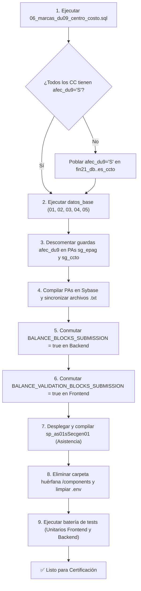

# Checklist Maestro de Validaciones y Reglas para Certificación y Producción

**Ecosistema:** SG-Solicitudes · Módulo de Prestación de Servicios (PDS DU288 / DU09)  
**Fecha de Elaboración:** 27-10-2026  
**Objetivo:** Consolidar en un solo documento operativo el catálogo de validaciones, interruptores temporales de desarrollo, condiciones en Procedimientos Almacenados (PAs) que deben limpiarse/activarse y la higiene de datos requerida antes del despliegue en los ambientes de **Certificación** y **Producción**.

---

## 1. Interruptores y Banderas de Desarrollo a Activar

Son mecanismos que se introdujeron deliberadamente en el código para permitir pruebas funcionales integrales sin bloquear el flujo cuando la base de datos de desarrollo carecía de ciertas marcas presupuestarias o biométricas.

### 1.1 El Interruptor Maestro: `INTERRUPTOR-DU09` (6 Puntos)

> **Contexto:** Temporalmente habilitado para probar el flujo de cuotas y el envío a visación DGDP mientras los centros de costo de prueba no tenían cargada la marca `afec_du9 = 'S'`.  
> **Comportamiento actual:** El saldo y la pertenencia a DU09 se evalúan e informan visualmente en pantalla (chips de advertencia/rojo), pero **no bloquean el botón ni el endpoint de envío**.

| Punto | Capa / Archivo | Ubicación exacta | Acción requerida para Certificación / Producción |
| :---: | :--- | :--- | :--- |
| **1** | **Frontend (Store)** | `sg-solicitudes-frontend/store/service-provision-payment-detail.js` (L23) | Cambiar `const BALANCE_VALIDATION_BLOCKS_SUBMISSION = false` a **`true`**. |
| **2** | **Backend (Controller)** | `sg-solicitudes-backend/src/controllers/service-provision/service-provision-payment.controller.ts` (L57) | Cambiar `const BALANCE_BLOCKS_SUBMISSION = false` a **`true`**. |
| **3** | **PA Inserción Cuota** | `nuevo_workflow_fase_2/template_wf_pagos/cambios_pa/sg_epag/sg_epagiSecgen01.sql` (L120-127) | Descomentar la guarda de `afec_du9`: borrar las líneas de comentario `/* INTERRUPTOR-DU09 ... */` para que ejecute `if @afec_du9 <> 'S' begin select 'Error: El centro de costo no pertenece al flujo DU09' as msg return end`. Recompilar en Sybase y sincronizar `sg_epagiSecgen01.txt`. |
| **4** | **PA Edición Cuota** | `nuevo_workflow_fase_2/template_wf_pagos/cambios_pa/sg_epag/sg_epaguSecgen01.sql` (L129-136) | Descomentar la misma guarda de `afec_du9`. Recompilar en Sybase y sincronizar `sg_epaguSecgen01.txt`. |
| **5** | **PA Envío a Visación** | `nuevo_workflow_fase_2/template_wf_pagos/cambios_pa/sg_epag/sg_epaguSecgen02.sql` (L104-111) | Descomentar la guarda de `afec_du9`. Recompilar en Sybase y sincronizar `sg_epaguSecgen02.txt`. |
| **6** | **PA Criterio Centro Costo** | `nuevo_workflow_fase_2/template_wf_pagos/cambios_pa/sg_ccto/sg_cctosSecgen05.sql` (L66-91) | Invertir los **dos** pares de `CRITERIO DU288`: cambiar `cod_tfinan in (21, 44)` por `ccto.afec_du9 = 'S'` tanto en el `CASE` indicador como en la cláusula `WHERE`. *(Requisito: que la columna esté poblada en `fin21_db..es_ccto`)*. Sincronizar `sg_cctosSecgen05.txt`. |

> [!WARNING]
> **Regla de Sincronía Front/Back:** Los puntos 1 y 2 deben conmutarse estrictamente al mismo tiempo. Si se enciende el backend y no el frontend, la pantalla se mostrará habilitada pero el botón fallará con error `HTTP 422 Unprocessable Entity`. Si se enciende el frontend y no el backend, el formulario bloqueará al usuario pero la API quedará desprotegida ante llamadas directas.

---

### 1.2 Rut de Prueba de Asistencia (Reloj Control)

- **Ubicación:** `sg-solicitudes-backend/src/repositories/storedProcedures/service-provision-payment-procedures.repository.ts` (L84).
- **Constante:** `const ATTENDANCE_TEST_RUT = '';`
- **Estado:** Actualmente vacía (`''`).
- **Regla:** Debe auditarse que en los archivos `.env` o en el repositorio **permanezca siempre en cadena vacía**. Si se le asigna un RUT, todas las consultas de la sección de jornada y reloj consultarán las marcas biométricas de esa persona simulada en lugar de las del funcionario evaluado.

---

### 1.3 Válvula de Autenticación de Desarrollo (`DISABLE_AUTH`)

- **Ubicación:** `sg-solicitudes-frontend/nuxt.config.js` (L58-L67).
- **Lógica:** Si `process.env.DISABLE_AUTH` es evaluado como verdadero en un entorno que no sea explícitamente `NODE_ENV === 'production'`, Nuxt deshabilita el middleware `['auth', 'guardian']`.
- **Regla:** En el archivo `.env` de Certificación y Producción, la variable `DISABLE_AUTH` debe ser removida o fijada en `false`, asegurando que `NODE_ENV=production` esté presente.

---

## 2. Validaciones Relajadas en el Formulario Solicitante (PDS DU288)

En el componente principal de solicitud (`components/services-provision/PdsDu288RequestForm.vue`), dos comprobaciones sobre el contrato del funcionario fueron relajadas para habilitar pruebas con perfiles históricos:

### 2.1 Funcionario sin Contratos Vigentes (`contracts.length === 0`)
- **Ubicación:** `PdsDu288RequestForm.vue` (L5019-L5023).
- **Comportamiento Actual:** Si la consulta de contratos vigentes no devuelve registros para el RUT ingresado, emite una advertencia flotante (`this.toast(NORMATIVE_MESSAGES.toast.noContractInfo, 'warning')`) y permite continuar la selección y el armado de la solicitud.
- **Acción para Certificación/Producción:** Una vez que la vista/fuente final de contratos institucionales vigentes esté conectada, este bloque debe volver a interrumpir la selección (`return` / bloquear asignación de contexto) impidiendo emitir solicitudes sobre funcionarios sin contrato habilitado.

### 2.2 Cobertura de Rango de Fechas del Contrato
- **Ubicación:** `PdsDu288RequestForm.vue` (L5816-L5819).
- **Comportamiento Actual:** La comparación entre la fecha de término del contrato del funcionario y las fechas de ejecución de la prestación fue comentada temporalmente para permitir contratos vencidos de prueba.
- **Acción para Certificación/Producción:** Reactivar la verificación para asegurar que la fecha de vigencia del contrato (`f_termino` / `f_termin_d`) sea igual o posterior a la última fecha de ejecución planificada de la prestación.

---

## 3. Validaciones Normativas Contempladas Pendientes de Fuente o Integración

Existen validaciones formalizadas en el marco normativo (D.U. 288 / D.U. 9 / Matriz de Pagos) que en la actualidad operan en modo diagnóstico o están a la espera de servicios externos:

| ID Control | Validación Normativa | Fuente Oficial | Estado Actual en Código | Acción Pendiente |
| :--- | :--- | :--- | :--- | :--- |
| **RES-IN-08 / PAG-37** | **Deuda Institucional** | Sin fuente integrada | Queda permanentemente en `status: 'pending'` (*"No hay fuente de datos para consultar deuda institucional..."*). | Conectar al futuro servicio financiero de tesorería. Será obligatoria e inhabilitante a contar del **01-01-2027**. |
| **PAG-36** | **Cierre del Proyecto a la fecha de ejecución** | `fin21_db` / `sg_fume.val_ciecc` | La columna existe y se lee, pero ningún PA transaccional bloquea si el proyecto cerró antes de la labor. | Incorporar guarda en el PA de envío/aprobación de cuota frente a la fecha de ejecución del mes. |
| **RES-CC-05 / PAG-39** | **Prohibición de Formación Continua** | Ficha del Centro de Costo | Verificado en panel visual pero sin bloqueo en la compuerta API de pago. | Asegurar que `ind_financiamiento_du288` descarte centros categorizados como educación continua. |
| **PAG-33 / PAG-34** | **Licencias Médicas y Permisos sin Goce automáticos** | `sisper_db..sp_as21` | En desarrollo la tabla está desierta. El revisor DGDP digita `mto_deslic` y `mto_dessg` a mano. | Crear el PA de ausencias agrupadas por rango de fecha para que el cálculo propuesto sea automático por días hábiles. |
| **RES-IN-07 / PAG-32** | **Constancia Jurada de Incompatibilidad / Parentesco** | Evidencia de resolución | Se difirió de la resolución al pago. En la pantalla de pago se visualiza el chip, pero no rechaza a nivel de compuerta si falta el documento. | Convertir en bloqueo duro durante la visación DGDP. |
| **RECESO** | **Receso Universitario No Acreditado** | Calendario institucional | Contemplado en la matriz pero no implementado como regla de validación en la compuerta. | Formalizar regla si la labor se ejecutó durante receso estival/invernal. |

---

## 4. Procedimientos Almacenados (PAs) y Scripts BDD: Guía de Despliegue

### 4.1 Script Previo Obligatorio (Diagnóstico de Afectación DU09)
Antes de activar los puntos 3, 4, 5 y 6 del `INTERRUPTOR-DU09`:
- **Ejecutar:** `nuevo_workflow_fase_2/template_wf_pagos/datos_base/06_marcas_du09_centro_costo.sql`.
- **Propósito:** Lista los centros de costo con resoluciones DU288 vigentes que tienen `afec_du9` nulo o vacío en `fin21_db..es_ccto`.
- **Paso correctivo:** Coordinar con Administración de Datos / Finanzas la actualización de `afec_du9 = 'S'` en dichos centros de costo. **No activar las guardas en los PAs si este paso no está subsanado**, de lo contrario los usuarios no podrán listar centros de costo ni gestionar cuotas.

### 4.2 Despliegue de Datos Base y Catálogos en Sybase ASE
Ejecutar los scripts de `nuevo_workflow_fase_2/template_wf_pagos/datos_base/` en el orden estricto indicado:
1. `01_sg_ecuo.sql`: Depura el catálogo de estados del **encabezado de cuota** (`sg_ecuo`), dejando activos únicamente los 7 estados oficiales (1, 6, 2, 3, 4, 8, 10) y eliminando los códigos en desuso (5, 7, 9, 11, 12).
2. `02_sg_efum.sql`: Carga el catálogo de estados del **mes de ejecución** (`sg_efum`) con sus 4 estados: `1 Propuesta`, `2 Comprometida`, `3 Enviada a pago`, `4 Rechazada`.
3. `03_migracion_sg_fume.sql`: Convierte las filas existentes en `sg_fume` de la columna obsoleta `cod_estcuo` a `cod_estfum`.
4. `04_roles_privilegios_pagos.sql`: Configura el Rol 33 (`PAGO_DGDP`) y asocia los privilegios correspondientes en `sistema_db..bd_per1` y `sistema_db..bd_prvg`.
5. `05_sg_tacc_acciones_pago.sql`: Registra en `sg_tacc` las acciones 32 (devolución) y 33 (rechazo) de cuotas para el historial de `sg_hist`.

### 4.3 Procedimiento de Reloj Control Diario
- **Archivo:** `nuevo_workflow_fase_2/template_wf_pagos/cambios_pa/asistencia/sp_as01sSecgen01.sql`.
- **Acción:** Compilar en el motor Sybase ASE otorgando permisos de ejecución a `UsuaVrac`. Cablear su llamada oficial en el backend sustituyendo la consulta directa de desarrollo.

---

## 5. Higiene del Repositorio y Limpieza de Código Muerto

Antes de generar el commit/tag para la rama de Certificación:

1. **Eliminar Directorio Huérfano `d:\trabajo_ufro_2026\components`:**
   - La carpeta ubicada en la raíz del espacio de trabajo contiene 3 archivos prototipo obsoletos (`PaymentInstallmentModal.vue`, `PaymentInstallmentsSection.vue`, `PaymentMonthsSection.vue`) ajenos a la estructura de Nuxt. Deben ser removidos del disco.
2. **Depuración de Variables de Entorno (`.env`):**
   - Eliminar cualquier array o string de `SIMULATION_USERS` utilizado para bypass de login o suplantación de identidad en pruebas locales.
3. **Purgado de Datos Transaccionales de Prueba en Base de Datos:**
   - Si se requiere reiniciar el ambiente de pruebas antes de la entrega, ejecutar el script `limpia_datos_pds_desarrollo.sql` para limpiar cuotas de prueba en `sg_epag`, detalles en `sg_dpag` y restablecer meses en `sg_fume`.

---

## 6. Secuencia Cronológica de Paso a Certificación (Paso a Paso)

1. **Paso 1 (BDD - Diagnóstico):** Correr `06_marcas_du09_centro_costo.sql` y regularizar centros sin marca.
2. **Paso 2 (BDD - Catálogos):** Aplicar scripts de `datos_base/` del 01 al 05.
3. **Paso 3 (PAs):** Descomentar las guardas de `afec_du9` en `sg_epagiSecgen01`, `sg_epaguSecgen01`, `sg_epaguSecgen02` y ajustar `sg_cctosSecgen05`. Sincronizar sus archivos `.txt`. Compilar en Sybase.
4. **Paso 4 (Backend):** Conmutar `BALANCE_BLOCKS_SUBMISSION = true` en `service-provision-payment.controller.ts`. Verificar `ATTENDANCE_TEST_RUT = ''`.
5. **Paso 5 (Frontend):** Conmutar `BALANCE_VALIDATION_BLOCKS_SUBMISSION = true` en `service-provision-payment-detail.js`. Verificar `DISABLE_AUTH = false` en `.env`.
6. **Paso 6 (Higiene):** Borrar carpeta huérfana `d:\trabajo_ufro_2026\components`.
7. **Paso 7 (Validación Técnica):**
   - Frontend: `npm test` (verificar 14/14 suites pasando) y `npx eslint` limpio.
   - Backend: `npm run test:unit` (verificar 231 tests pasando) y `npm run build` sin errores.
