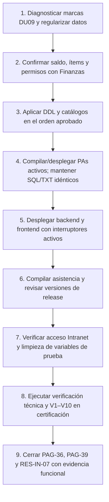

# Checklist Maestro de Validaciones y Reglas para Certificación y Producción

**Ecosistema:** SG-Solicitudes · Módulo de Prestación de Servicios (PDS DU288 / DU09)  
**Fecha de Elaboración:** 27-10-2026  
**Actualizado:** 06-11-2026, contraste de código, scripts y flujo de autenticación. Los interruptores presupuestarios están activos en el código y los PA de entrega; se retiró el simulador de acceso y su bypass de autenticación. La compilación en Sybase, los datos y la evidencia del ambiente siguen pendientes.  
**Objetivo:** Consolidar en un solo documento operativo el catálogo de validaciones, interruptores temporales de desarrollo, condiciones en Procedimientos Almacenados (PAs) que deben limpiarse/activarse y la higiene de datos requerida antes del despliegue en los ambientes de **Certificación** y **Producción**.

---

## 0. Estado ejecutivo verificado el 06-11-2026

| Qué | Dónde | Estado |
| :--- | :--- | :--- |
| `INTERRUPTOR-DU09`, puntos 1 y 2 | Store de pagos y controller backend | ✅ `true`; saldo bloquea envío y aprobación en la UI, y el servidor protege envío y aprobación directa. |
| `INTERRUPTOR-DU09`, puntos 3 a 6 | Tres PA de cuota y `sg_cctosSecgen05` | ✅ Guardas activas, criterio `afec_du9` activo y pares SQL/TXT idénticos en la entrega. ⛔ Instalación de esta versión y permisos pendientes en certificación. |
| Mensaje «Modo de prueba» de pagos | Componente y traducciones | ✅ Retirado |
| Saldo en WF resolución | Formulario y repositorio backend | ✅ Bloquea envío y el servidor vuelve a consultar saldo. |
| Fechas y contrato en WF resolución | Formulario y repositorio backend | ✅ El envío exige fechas válidas y ejecución no vencida. El servidor comprueba el contrato seleccionado y la cobertura del período contra SISPER. |
| Ítem presupuestario en WF resolución | Perfil SISPER, formulario y compuerta de envío | ✅ Se usa el ítem de contrato informado o la equivalencia por estamento conocido (1 → 300, 2 → 303, 3 → 306). El servidor rechaza un ítem faltante o distinto del derivado. |
| Datos y presentación de desarrollo | Backend y bandejas de resolución | ✅ Se retiraron los catálogos emulados sin referencias. Las fechas ausentes se muestran como «—». |
| Condiciones de centro de costo en WF resolución | `validateRequestCostCenterConditions` | ✅ Revalida al enviar: centro vigente, responsable, marca DU288/DU09, financiamiento, tope de cuotas informado, formación continua, ítem y saldo. |
| Aprobación por etapa en WF resolución | Acciones disponibles y compuerta del servidor | ✅ Aprobar, enviar a firma y archivar muestran el motivo de bloqueo. El servidor vuelve a consultar el centro y FIN21 antes de registrar la decisión y avanzar. |
| Login de prueba y bypass de autenticación | Frontend, backend y variables expuestas al bundle | ✅ Retirados del código versionado; desarrollo usa Intranet. Los parches antiguos quedan archivados y no deben aplicarse (`login_simulado_desarrollo.md`). |
| Compuerta de aprobación DGDP | `assertDgdpApprovalCompliance` | ✅ Revalida respaldo de cuota, tope (salvo extensión), DU09 (incluye dato faltante), saldo y verificación de parentesco. ⛔ La presencia de constancia requerida aún no se verifica positivamente. El contrato no se revalida por desfase administrativo de pago. |
| Deuda institucional (§3) | `messages.js`, `config.js` | ✅ Se informa como **fuera del alcance** (decisión de ClickUp del 23-10-2026), no como «pendiente» |
| Restos de desarrollo | selector de año de pagos (desde 2026), comentario `todo` en `resolution-document.controller.ts` | ✅ Retirados |

**Verificación del 06-11-2026:** se revisaron las compuertas en fuente y se hicieron consultas de lectura en la base de desarrollo conectada. La asignación FIN21 del centro 9010.36, folio `90103601`, tiene una línea `30600` por $200.000. `valida_saldo_cc_cs` devolvió `Saldo = 200000` y `Estatus = 1` al evaluar $111.111 con el código `306` que envía la pantalla. Esto acredita el caso positivo del PA en desarrollo. Falta el recorrido de pantalla/API y la evidencia del ambiente de certificación.

En la misma base se encontraron `sg_efum`, `sg_epag`, `sg_dpag`, `sg_com1`, los cuatro PA del interruptor y `sp_as01sSecgen01`. La presencia de los objetos solo acredita su existencia en desarrollo. Sigue pendiente contrastar la estructura, los procedimientos y los permisos en certificación. La entrega de datos fijos no incluye DDL ni migraciones históricas.

**Pendientes comprobables antes de certificar:**

1. **Datos:**
   - ejecutar el diagnóstico `06_marcas_du09_centro_costo.sql` y regularizar marcas `afec_du9 = 'S'` caso a caso (R1);
   - confirmar con Finanzas la versión y los casos de borde de `valida_saldo_cc_cs` (R2). El PA instalado en desarrollo devuelve `Mensaje`, `Estatus` y `Saldo` y difiere del paquete local que agrega remanente y una excepción para ciertos subítems de Fondos Propios;
   - revisar que las prestaciones de certificación tengan ítem presupuestario (R3) y contrastar la equivalencia de estamento para los tres tipos de funcionario.
2. **Despliegue:**
   - compilar los PA de los puntos 3 a 6 y los nuevos de esta entrega (`sg_fupssSecgen17`, `sg_fucosSecgen02`, `sg_fupssSecgen19`), además de `sp_as01sSecgen01`;
   - confirmar con el equipo de base de datos que certificación tenga el esquema vigente de pagos;
   - usar la versión de `sg_usacsSecgen01` de `cambios_pa`.
3. **Verificación:** V1 a V10 de `INTERRUPTOR-DU09.md` §5 en certificación.
4. **Login institucional:** verificar credenciales/API Intranet y `LOGIN_URL`; no aplicar los parches históricos del simulador (§1.3).

## Historial de estado anterior (04-11-2026; no usar para decidir el estado actual)

| # | Elemento | Estado |
|:-:|:--|:--|
| 1.0 | Saldo del centro de costo en **WF resolución** | ⛔ Apagado entonces; estado actual ✅ activo y revalidado por servidor |
| 1.1 | `INTERRUPTOR-DU09` en **WF pagos** (6 puntos) | ⛔ Apagado entonces; estado actual ✅ activo en código y fuentes PA |
| 1.2 | RUT de prueba de asistencia | ✅ Retirado el 03-11-2026 |
| 1.3 | `DISABLE_AUTH` y login simulado | Se documentó retirado el 05-11; el contraste encontró el bypass reintroducido y lo retira nuevamente el 06-11 |
| 2.1 | Funcionario sin contratos vigentes | ⛔ Relajado (solo advierte; sin contrato no se puede agregar al funcionario) |
| 2.2 | Contrato que cubre la ejecución y ejecución no vencida | ✅ Activas en pantalla y servidor desde el 04-11-2026 (WF resolución); no aplican al pago |
| 3 | Validaciones normativas sin fuente o sin compuerta | Ver tabla §3 |
| 3.1 | Condiciones del centro de costo en WF resolución | Estado documentado el 04-11; actual: revalidación de servidor activa al enviar |
| 4.3 | PA de asistencia `sp_as01sSecgen01` | ✅ Cableado en backend · ⛔ falta compilar en Sybase |
| 5.1 | Carpeta huérfana `components` | ✅ Eliminada |
| — | Núcleo: cupo, topes y cruces entre prestaciones (N1 a N11) | ✅ Aplicado el 03 y 04-11-2026; tope y cupo por centro de costo. Detalle en `auditoria_validaciones_certificacion_2026_11_03.md` §13.5 |

---

## 1. Interruptores de Validación y Variables de Desarrollo

Los interruptores de validación que antes se relajaban para pruebas ya están activos. Las banderas de autenticación/prueba se retiraron del código versionado.

### 1.0 Saldo del centro de costo en WF resolución

| Capa | Ubicación | Estado verificado | Pendiente |
| :--- | :--- | :--- | :--- |
| Frontend | `components/services-provision/PdsDu288RequestForm.vue` | ✅ El saldo pendiente o no disponible bloquea el envío. Se retiraron los interruptores locales de saldo y la consulta informativa alterna. | Verificar con Finanzas los casos con saldo, sin saldo y sobregiro autorizado en certificación |
| Backend | `validateRequestCostCenterConditions` en `service-provision-request-procedures.repository.ts` | ✅ Reconsulta saldo al enviar y rechaza respuesta no válida o no disponible | Verificar permisos y respuesta real de `valida_saldo_cc_cs` en Sybase |

El servidor recibe la verificación de condiciones del centro de costo al enviar; guardar borrador no dispara esta compuerta. No volver a agregar la advertencia antigua de que la pantalla es la única protección.

### 1.1 El Interruptor Maestro: `INTERRUPTOR-DU09` (6 Puntos) — WF pagos

> **Estado actual:** los seis puntos están activos en fuentes de aplicación/PA. La compilación Sybase y el estado de datos por ambiente aún requieren evidencia. Las instrucciones históricas de conmutación están en `INTERRUPTOR-DU09.md`; no repetir el cambio de `false` a `true`.

| Punto | Capa / Archivo | Estado en fuentes | Acción de certificación |
| :---: | :--- | :--- | :--- |
| **1** | **Frontend (Store)** | `store/service-provision-payment-detail.js` | ✅ `BALANCE_VALIDATION_BLOCKS_SUBMISSION = true`; gobierna bloqueo visual de envío y aprobación DGDP. |
| **2** | **Backend (Controller)** | `service-provision-payment.controller.ts` | ✅ `BALANCE_BLOCKS_SUBMISSION = true`; protege envío y se reutiliza en la compuerta DGDP. |
| **3** | **PA Inserción Cuota** | `cambios_pa/sg_epag/sg_epagiSecgen01.sql/.txt` | ✅ Guarda `afec_du9` activa; par idéntico. Compilación ASE pendiente de evidencia. |
| **4** | **PA Edición Cuota** | `cambios_pa/sg_epag/sg_epaguSecgen01.sql/.txt` | ✅ Guarda `afec_du9` activa; par idéntico. Compilación ASE pendiente de evidencia. |
| **5** | **PA Envío a Visación** | `cambios_pa/sg_epag/sg_epaguSecgen02.sql/.txt` | ✅ Guarda `afec_du9` activa; par idéntico. Compilación ASE pendiente de evidencia. |
| **6** | **PA Criterio Centro Costo** | `cambios_pa/sg_ccto/sg_cctosSecgen05.sql/.txt` | ✅ CASE y filtro se basan en `afec_du9 = 'S'`; par idéntico. Compilación ASE pendiente de evidencia. |

> [!WARNING]
> **Regla de Sincronía Front/Back:** Los puntos 1 y 2 deben conmutarse estrictamente al mismo tiempo. Si se enciende el backend y no el frontend, la pantalla se mostrará habilitada pero el botón fallará con error `HTTP 422 Unprocessable Entity`. Si se enciende el frontend y no el backend, el formulario bloqueará al usuario pero la API quedará desprotegida ante llamadas directas.

> [!IMPORTANT]
> **El punto 1 gobierna dos pantallas.** Desde el 28-10-2026 la aprobación DGDP lee el mismo interruptor (`balanceBlocks: this.balanceBlocksSubmission` en `pages/services-provision/payments/review/_staffProvisionId/_installmentNumber.vue`). Antes lo tenía fijo en `true`, de modo que el saldo impedía aprobar aun con el interruptor apagado. Al conmutarlo vuelven a bloquear el **envío** del solicitante y la **aprobación** DGDP, y la verificación debe cubrir las dos.

La compuerta del servidor para aprobar existe desde el 06-11-2026 y se describe en §3. Los puntos 1 y 2 deben permanecer sincronizados en futuras modificaciones.

La pantalla de envío y la revisión DGDP bloquean si la marca DU09 falta o difiere de `S`. La API confirma la marca al enviar y al aprobar a partir de los procedimientos que proyectan `afec_du9`.

---

### 1.2 Rut de Prueba de Asistencia (Reloj Control) — ✅ retirado

- **Retirado el 03-11-2026** y verificado el 04-11-2026: la constante `ATTENDANCE_TEST_RUT`, su getter, el campo `attendanceTestRut` de la respuesta y el aviso de la pantalla ya no existen. La consulta de asistencia usa siempre el RUT del funcionario evaluado.
- **Ubicación anterior:** `sg-solicitudes-backend/src/repositories/storedProcedures/service-provision-payment-procedures.repository.ts`.

---

### 1.3 Simulación de acceso y bypass de autenticación — retirados del código versionado

- El frontend `/access` solo ofrece el enlace a Intranet y ya no contiene selector de usuario simulado.
- `SIMULATION_USERS` y `SIMULATION_USERS_CATALOG` ya no se exponen mediante `@nuxtjs/dotenv`.
- El backend siempre valida el RUT contra Intranet; `INTRANET_AUTH_FLOW` ya no conmuta la validación.
- No se detectó `DISABLE_AUTH` en los repositorios de aplicación durante este contraste.
- Los parches antiguos en `nuevo_workflow_fase_2/login_simulado/` no son compatibles con el código actual y no deben aplicarse. Revisar `.env` de cada ambiente por separado sin copiar sus valores al repositorio.

---

## 2. Validaciones del Contrato y del Período en el Formulario Solicitante (PDS DU288)

En el componente principal de solicitud (`components/services-provision/PdsDu288RequestForm.vue`) la búsqueda de funcionario se interrumpe si no hay contrato vigente. La cobertura contractual y la fecha de ejecución también se validan (§2.1–2.2).

### 2.1 Funcionario sin Contratos Vigentes (`contracts.length === 0`) — ✅ bloqueante
- **Ubicación:** `PdsDu288RequestForm.vue`, `applyStaffFromSearch`.
- **Comportamiento actual:** si la consulta no devuelve contratos, muestra `noCurrentContract` como error y retorna antes de crear/aplicar el contexto del funcionario.
- **Servidor al enviar:** el contrato seleccionado debe existir entre los contratos que devuelve `sg_fupssSecgen13` para ese funcionario. Verificar que un perfil sin contrato no se pueda agregar ni enviar, incluso por llamada directa.

### 2.2 Contrato que cubre la ejecución y ejecución no vencida — ✅ activa

> **Regla confirmada el 04-11-2026.** En **WF resolución** no se puede solicitar una prestación con el **contrato vencido** ni con el **período de ejecución vencido**. En **WF pagos** sí se paga: la resolución ya está hecha y archivada, y un contrato no vigente no bloquea cuotas ya trabajadas.

**Reglas**

1. **Cobertura** (`contexto_reglas_cambios_agregados/07`, §2.1): el contrato debe estar vigente durante **todo** el período de ejecución del funcionario: inicio del contrato ≤ inicio de la ejecución y término del contrato ≥ término de la ejecución. Un contrato sin fecha de término (indefinido) cumple.
2. **Ejecución no vencida** (agregada el 04-11-2026): el término de la ejecución, el general y el de cada funcionario, debe ser hoy o posterior. Una ejecución que empezó antes de hoy y sigue en curso sí se puede solicitar.

Las dos juntas impiden el contrato vencido: si el contrato cubre una ejecución que todavía no termina, sigue vigente.

**Dónde se aplican (verificado el 04-11-2026)**

| Momento | Regla | Función | Mensaje o código |
| :--- | :--- | :--- | :--- |
| Al agregar o editar el funcionario | Ejecución no vencida | `getPeriodValidationErrors`, `getWorkerExecutionPeriodErrors` | «El período de ejecución ya terminó…» / «… tiene el período de actividad ya terminado…» |
| Al agregar o editar el funcionario | Cobertura | `validateWorkerActivityAndAmount` | «El contrato seleccionado no cubre los meses de ejecución …» (`CONTRATO_NO_CUBRE_MESES`) |
| Al enviar, por cada fila del resumen | Las dos | `validateRequest`, `validateWorkerContractAndCoverage`, `validateStaffSummaryRowExecutionPeriod` | Mismos mensajes, por fila |
| Al **reabrir** una solicitud guardada, contra el perfil vigente de SISPER | Cobertura | `buildCurrentProfileAlerts` | «El contrato guardado ya no cubre el período de ejecución del funcionario.» (`CONTRATO_NO_CUBRE_EJECUCION`, reactivada el 04-11-2026) |
| En el servidor, al guardar borrador | Cobertura de las fechas contractuales informadas | `validateStaffContractValidity` | 422 si las fechas informadas demuestran que el contrato no cubre el rango de ejecución. |
| En el servidor, al **enviar** | Fechas válidas, ejecución no vencida y cobertura oficial | `validateNormativeRequestStaff` y `validateCurrentStaffContract` | 422 por fechas ausentes o inválidas, ejecución vencida, contrato no acreditado o falta de cobertura. El borrador permite corregir fechas de ejecución vencidas. |

- **Detalle del servidor:** al enviar se exige fecha de inicio acreditada en SISPER. Un contrato sin término informado se admite como indefinido. Se comprueba que el contrato cubra las fechas de ejecución del funcionario con los datos devueltos por el procedimiento.
- **WF pagos:** no se revalida, por decisión: un contrato no vigente en SISPER no bloquea cuotas ya devengadas, por desfase administrativo de pago (`assertInstallmentNormativeCompliance`). La matriz (§4.2) deja abierta si debe exigirse que cubra el período que se paga.
- **Pruebas:** `service-provision-core-cross-checks.unit.ts`, bloque «ejecucion vencida».
- **Acción para Certificación/Producción:** verificar el procedimiento instalado y probar envío con contrato indefinido, contrato vencido, contrato ajeno, fechas inválidas y ejecución que termina hoy.

---

## 3. Validaciones Normativas Contempladas Pendientes de Fuente o Integración

Existen validaciones formalizadas en el marco normativo (D.U. 288 / D.U. 9 / Matriz de Pagos) que en la actualidad operan en modo diagnóstico o están a la espera de servicios externos:

| ID Control | Validación Normativa | Fuente Oficial | Estado actual | Acción pendiente |
| :--- | :--- | :--- | :--- | :--- |
| **RES-IN-08 / PAG-37** | **Deuda Institucional** | Sin fuente integrada | ✅ **Fuera del alcance** (decisión de ClickUp del 23-10-2026, corregido el 06-11-2026): se informa como «Deuda institucional: fuera del alcance» y no se consulta. Que no se consulte no equivale a «sin deuda». | Ninguna. La versión anterior de este punto decía que sería obligatoria desde el 01-01-2027; la decisión de ClickUp lo descarta: no se activa sola. Encenderla exige una decisión nueva y una fuente de datos. |
| **PAG-36** | **Cierre del Proyecto a la fecha de ejecución** | `fin21_db` / `sg_fume.val_ciecc` | ⛔ Se consulta en reportes; no se confirmó guarda transaccional al enviar/aprobar cuota. | Acordar regla y fecha de referencia con Finanzas/DGDP; luego implementar en PA transaccional de pago y verificar en Sybase. No inferir que valor nulo equivale a proyecto abierto. |
| **RES-CC-05 / PAG-39** | **Prohibición de Formación Continua** | Ficha del Centro de Costo | ✅ WF resolución valida servidor al enviar. ⛔ No se encontró bloqueo equivalente en la compuerta del pago ni en los PA transaccionales de cuotas. | Confirmar la regla aplicable a cuotas ya autorizadas y agregar compuerta backend/PA de pago si corresponde; no se resuelve solo con el interruptor de saldo/DU09. |
| **PAG-33 / PAG-34** | **Licencias Médicas y Permisos sin Goce** | Marcaje biométrico (`sp_as01sSecgen01`) | ✅ **Decidido el 04-11-2026:** se ve solo en WF pagos. La única fuente automática es el marcaje biométrico cuando el día viene con un tipo de licencia o permiso, y la sección de asistencia de la cuota ya lo muestra (ausencia con motivo y justificación). Lo demás lo ajusta DGDP con documento explícito (`mto_deslic`, `mto_dessg`). | **Ya no se crea** el PA de ausencias sobre `sisper_db..sp_as21` que pedía la versión anterior de este checklist. |
| **RES-IN-07 / PAG-32** | **Constancia Jurada de Incompatibilidad / Parentesco** | Evidencia y relación funcionario/jefe de proyecto | ⚠️ La aprobación DGDP consulta parentesco en servidor; si no puede verificarlo o la relación exige constancia, rechaza. No se acreditó una validación positiva de que la constancia exigida esté efectivamente adjunta y sea la correspondiente. | Definir dónde se persiste/identifica la constancia y validar su presencia al aprobar; probar llamada directa al endpoint y los casos con/sin parentesco. No describir el control como «constancia verificada» hasta entonces. |
| **PAG-38** | **Cobertura de la compensación comprometida por la realizada** | `sg_fuco` / `sg_fuc2` | ⚠️ El detalle DGDP documenta bloqueo al enviar. En la página del solicitante de pagos, el indicador de compensación faltante se genera como advertencia con `blocking: false`. No se encontró esa guarda en la ruta de envío revisada ni en `sg_epaguSecgen02`. | Confirmar la regla de bloqueo y, si corresponde, aplicar la guarda para los meses de la cuota en servidor. La fuente para esta regla es el contraste declarativo, de acuerdo con la decisión de asistencia. |
| **RECESO** | **Receso Universitario No Acreditado** | Calendario institucional | ✅ Mismo criterio que licencias: no es una regla automática. DGDP rechaza el mes con su causal (estado de mes «rechazado», que no consume saldo) apoyado en documento explícito. | Ninguna, salvo que se decida automatizarlo. |

### 3.1 Compuertas de WF resolución y aprobación DGDP

- WF resolución vuelve a consultar en servidor vigencia del centro, vigencia del responsable, compatibilidad DU288, Formación Continua, ítem presupuestario y saldo al enviar la solicitud. El control de cliente no es la única barrera.
- La aprobación DGDP invoca `assertDgdpApprovalCompliance` solo al aprobar; devolver/rechazar siguen su flujo propio. La compuerta comprueba evidencia de cuota, tope salvo extensión, pertenencia DU09, saldo y parentesco.
- En la pertenencia DU09 de aprobación, el backend ahora exige valor exactamente `S`; dato vacío también bloquea. No relajar esta condición por falta de proyección del PA.
- El tope/contrato SISPER de una cuota devengada no se revalida en pago por desfase administrativo. Formación Continua y cierre del proyecto en el PA transaccional de pago quedan como controles a resolver antes de cerrar PAG-39/PAG-36.
- La verificación de parentesco es fail-closed, pero el modelo de evidencia no demuestra todavía que una constancia requerida está adjunta y validada. Resolver esa brecha según la fila RES-IN-07/PAG-32.

### 3.2 Hallazgos técnicos de auditoría que siguen abiertos

- **D-02 · Mes de pago DGDP.** El cambio actual filtra por prestación y cuota. Falta limitarlo al estado editable y confirmar una fila modificada.
- **D-05 · Equivalencia de ítems en conciliación.** El indicador `item_coincide` compara los códigos de SG y SISPER directamente. Aún puede mostrar una diferencia para la pareja válida `306` / `30600`.
- **D-07 · Historial de prestaciones.** Las acciones del store devuelven una lista vacía cuando falla la consulta. Falta conservar y comunicar el error.
- **D-12 · Entrega del resumen de pagos. Corregido en archivos.** El SQL y TXT de `sg_fupssSecgen18` son idénticos e incluyen el resumen de cuotas devueltas. Falta confirmar la versión instalada en certificación.
- **D-13 · Inhabilidades por contrato y asignación.** La pantalla puede impedir seleccionar un contrato habilitado si otro contrato consultado está inhabilitado. La API de resolución valida el seleccionado. En el envío de pagos, las asignaciones bloquean ante `N` explícito. Queda por alinear el tratamiento de un valor vacío y el alcance por contrato.
- **D-03, D-08, D-09, D-10 y D-11.** Recontrastar editor/historial, persistencia parcial en SISPER, concurrencia, presentación de la extensión y descarga financiera. La auditoría original describe las diferencias y sus pruebas pendientes. **D-04** corrigió el criterio documental de meses del cupo anual. Queda la evidencia funcional de ese criterio en certificación.

### 3.3 Condiciones del centro y datos sin informar en WF resolución

- **Bloqueos al enviar.** RES-CC-01/02/03/04/06/07 requieren centro asociado y vigente, responsable vigente, financiamiento compatible, flujo configurado y saldo suficiente. La pertenencia a DU09 exige `afec_du9 = 'S'` en el catálogo institucional. El resultado de saldo se puede consultar por separado de la elegibilidad.
- **Aprobación por etapa.** La pantalla consulta la elegibilidad vigente para habilitar las acciones de aprobación. Al ejecutar una aprobación el servidor repite la validación con el centro, ítem y monto persistidos, antes de cambiar la tarea, escribir el historial o avanzar la etapa. La consulta a FIN21 ocurre antes de abrir la transacción del workflow porque el PA crea tablas temporales. Devolver a corrección y rechazar conservan su ruta. Falta verificar el recorrido completo y sigue pendiente la historización del saldo por etapa.
- **Decreto afecto y régimen de cuotas.** El decreto se muestra cuando está informado. La pertenencia se confirma con `afec_du9 = 'S'`. La pantalla y el servidor bloquean el envío si `con_topdu9` falta o tiene un valor distinto de `S` o `N`. La autorización de extensión es el dato `ext_cuotas` de la resolución.
- **Formación Continua.** RES-CC-05 bloquea si la fuente identifica que aplica. RF-P01-013D exige mostrar «No determinada» y dejar trazabilidad si no se puede determinar. El código revisado solo bloquea ante `S`. Además, el PA del catálogo hoy devuelve `N` para cualquier decreto distinto de `1`, incluso nulo. Queda pendiente confirmar con Finanzas/DGDP si esa equivalencia está formalmente validada y cómo se resuelve un dato desconocido.
- **Fuente del formulario DU288.** Al elegir el responsable o reabrir un borrador se consulta su catálogo DU288. La selección guardada se cruza por unidad y código para recuperar las marcas vigentes. En desarrollo, `sg_cctosSecgen05` devolvió para 9010.36 decreto `2` (No Afecto), DU09 `S`, con tope `S` y Formación Continua `N`. El PA de saldo devolvió $200.000 y `Estatus = 1` para $111.111. Falta confirmar el recorrido desde la pantalla.
- **Centros excluidos del catálogo.** La ficha de una solicitud existente consulta las marcas del maestro FIN21 y la asociación con el responsable guardado aunque el catálogo DU288 excluya el centro. La vista distingue las condiciones conocidas de los datos sin informar. El envío y la aprobación siguen exigiendo vigencia y pertenencia al catálogo.

---

## 4. Procedimientos Almacenados (PAs) y Scripts BDD: Guía de Despliegue

### 4.1 Script Previo Obligatorio (Diagnóstico de Afectación DU09)
Antes de compilar/desplegar los puntos 3, 4, 5 y 6 del `INTERRUPTOR-DU09`:
- **Ejecutar:** `nuevo_workflow_fase_2/template_wf_pagos/soporte_certificacion/06_marcas_du09_centro_costo.sql`.
- **Propósito:** Lista los centros de costo con resoluciones DU288 vigentes que tienen `afec_du9` nulo o vacío en `fin21_db..es_ccto`.
- **Paso correctivo:** Coordinar con Administración de Datos / Finanzas la actualización de `afec_du9 = 'S'` en dichos centros de costo. **No activar las guardas en los PAs si este paso no está subsanado**, de lo contrario los usuarios no podrán listar centros de costo ni gestionar cuotas.

### 4.2 Despliegue de Datos Base y Catálogos en Sybase ASE

Confirmar primero el esquema vigente. Aplicar la [carga de datos fijos](datos_base/README.md) en el orden indicado: estados de cuota y mes, acciones DGDP, perfil y privilegios. La estructura y las filas históricas se gestionan por separado. Instalar los procedimientos del [inventario](cambios_pa/inventario_certificacion.md) con sus permisos; los compartidos con resolución deben salir en la misma ventana que el backend.

### 4.3 Procedimiento de Reloj Control Diario
- **Archivo:** `nuevo_workflow_fase_2/template_wf_pagos/cambios_pa/asistencia/sp_as01sSecgen01.sql`.
- **Estado (04-11-2026):** ✅ el backend ya lo llama (consulta `secgen_db.Analisis2.sp_as01sSecgen01` en `db-assets/.../service-provision-payment.ts`). Falta compilarlo en Sybase ASE con permiso de ejecución para `UsuaVrac`.
- Es además la única fuente automática de licencias y permisos en el pago (§3, PAG-33/34).

---

## 5. Higiene del Repositorio y Limpieza de Código Muerto

Antes de generar el commit/tag para la rama de Certificación:

1. ✅ **Directorio huérfano `d:\trabajo_ufro_2026\components`:** ya no existe (verificado el 04-11-2026).
2. **Depuración de Variables de Entorno (`.env`):**
   - El código versionado ya no lee `SIMULATION_USERS`, `SIMULATION_USERS_CATALOG` ni `INTRANET_AUTH_FLOW`; `DISABLE_AUTH` tampoco debe aparecer en configuración de certificación/producción. Limpiar esos nombres de los `.env` del ambiente sin divulgar sus valores.
3. **Login institucional** (§1.3): confirmar que `LOGIN_URL` apunta a Intranet y que las variables de simulación/bypass no están configuradas en el ambiente.
4. **Purgado de Datos Transaccionales de Prueba en Base de Datos:**
   - Si se requiere reiniciar el ambiente de pruebas antes de la entrega, ejecutar el script `limpia_datos_pds_desarrollo.sql` para limpiar cuotas de prueba en `sg_epag`, detalles en `sg_dpag` y restablecer meses en `sg_fume`.
5. **Consulta de saldo directa:** se retiró la acción frontend `getCostCenterBalance` y su rama informativa. El formulario usa `validateNormativeCostCenterBalance` y el servidor vuelve a verificar el saldo al enviar.

---

## 6. Secuencia Cronológica de Paso a Certificación (Paso a Paso)

1. Diagnosticar `afec_du9` con `06_marcas_du09_centro_costo.sql`; regularizar cada centro autorizado antes de desplegar las guardas.
2. Confirmar con Finanzas el PA de saldo, permisos de `UsuaVrac`, escenarios con/sin saldo y existencia de ítem presupuestario.
3. Confirmar el esquema con el equipo de base de datos y aplicar [los datos fijos de pagos](datos_base/README.md).
4. Compilar los PA DU09 ya activos en las fuentes y sincronizados con `.txt`; no descomentar ni reconmutar nada. Instalar también los PA indicados para esta entrega y `sp_as01sSecgen01`.
5. Desplegar el backend y frontend que ya llevan las compuertas encendidas. Mantener ambos interruptores de saldo en `true`.
6. Revisar que la compilación de acceso use el flujo real de Intranet; verificar que los nombres de variables de simulación/bypass no existan en `.env` de certificación/producción.
7. Ejecutar la verificación técnica correspondiente a la rama de entrega y V1–V10 en el ambiente de certificación, guardando resultados/evidencias.
8. Resolver PAG-36, PAG-39 y RES-IN-07 según §3; estos controles no quedan cubiertos por activar DU09/saldo.
9. Cerrar el pase solo cuando exista evidencia de Sybase, datos, permisos y pruebas end-to-end en certificación.
