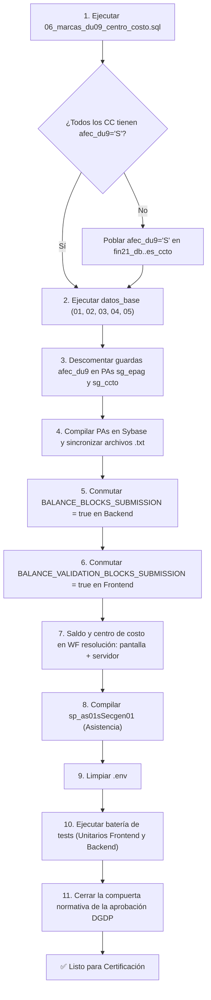

# Checklist Maestro de Validaciones y Reglas para Certificación y Producción

**Ecosistema:** SG-Solicitudes · Módulo de Prestación de Servicios (PDS DU288 / DU09)  
**Fecha de Elaboración:** 27-10-2026  
**Corregido:** 03-11-2026, según `auditoria_validaciones_certificacion_2026_11_03.md` §1 y §3 (líneas, scripts de base, `DISABLE_AUTH`, RUT de prueba y conteo de pruebas).  
**Actualizado:** 04-11-2026, verificado contra el código: qué quedó implementado, qué sigue apagado y qué se agrega (saldo en WF resolución, §1.0; validaciones del centro de costo solo en pantalla, §3.1; decisión sobre licencias y receso, §3).  
**Actualizado:** 04-11-2026 (tarde): reglas de contrato y ejecución vencida en WF resolución (§2.2), login simulado retirado otra vez (§1.3), referencias de línea y conteo de pruebas al día.  
**Objetivo:** Consolidar en un solo documento operativo el catálogo de validaciones, interruptores temporales de desarrollo, condiciones en Procedimientos Almacenados (PAs) que deben limpiarse/activarse y la higiene de datos requerida antes del despliegue en los ambientes de **Certificación** y **Producción**.

---

## Resumen de estado al 04-11-2026

| # | Elemento | Estado |
|:-:|:--|:--|
| 1.0 | Saldo del centro de costo en **WF resolución** | ⛔ **Apagado** en pantalla y **sin validación** en el servidor |
| 1.1 | `INTERRUPTOR-DU09` en **WF pagos** (6 puntos) | ⛔ **Apagado** los 6 |
| 1.2 | RUT de prueba de asistencia | ✅ Retirado el 03-11-2026 |
| 1.3 | `DISABLE_AUTH` y login simulado | ✅ Retirados del código el 03-11-2026 (reactivado para pruebas y retirado otra vez el 04-11-2026) |
| 2.1 | Funcionario sin contratos vigentes | ⛔ Relajado (solo advierte; sin contrato no se puede agregar al funcionario) |
| 2.2 | Contrato que cubre la ejecución y ejecución no vencida | ✅ Activas en pantalla y servidor desde el 04-11-2026 (WF resolución); no aplican al pago |
| 3 | Validaciones normativas sin fuente o sin compuerta | Ver tabla §3 |
| 3.1 | Condiciones del centro de costo en WF resolución | ⚠️ Solo en pantalla |
| 4.3 | PA de asistencia `sp_as01sSecgen01` | ✅ Cableado en backend · ⛔ falta compilar en Sybase |
| 5.1 | Carpeta huérfana `components` | ✅ Eliminada |
| — | Núcleo: cupo, topes y cruces entre prestaciones (N1 a N11) | ✅ Aplicado el 03 y 04-11-2026; tope y cupo por centro de costo. Detalle en `auditoria_validaciones_certificacion_2026_11_03.md` §13.5 |

---

## 1. Interruptores y Banderas de Desarrollo a Activar

Son mecanismos que se introdujeron deliberadamente en el código para permitir pruebas funcionales integrales sin bloquear el flujo cuando la base de datos de desarrollo carecía de ciertas marcas presupuestarias o biométricas.

### 1.0 Saldo del centro de costo en WF resolución (agregado el 04-11-2026)

No forma parte del `INTERRUPTOR-DU09`: es otro interruptor, del formulario de solicitud.

| Capa | Ubicación | Estado | Acción |
| :--- | :--- | :--- | :--- |
| Frontend | `components/services-provision/PdsDu288RequestForm.vue` (L763) | `enableCostCenterBalanceSubmitValidation: false`. El saldo se calcula y se muestra (chip «Sin saldo disponible» en rojo), pero **no impide enviar** | Cambiar a `true` cuando Finanzas confirme `fin21_db.Analisis.valida_saldo_cc_cs` y sus casos de prueba (nota del propio código) |
| Backend | `validateNormativeRequestStaff` | **No existe** validación de saldo al guardar o enviar la solicitud: el endpoint `validateNormativeCostCenterBalance` solo responde consultas de la pantalla | Agregar la revalidación en el servidor al encender la de pantalla, como se hizo con la Regla 11 (N4) |

> Encender solo la pantalla deja el envío protegido en el navegador y abierto a una llamada directa a la API.

### 1.1 El Interruptor Maestro: `INTERRUPTOR-DU09` (6 Puntos) — WF pagos

> **Contexto:** Temporalmente habilitado para probar el flujo de cuotas y el envío a visación DGDP mientras los centros de costo de prueba no tenían cargada la marca `afec_du9 = 'S'`.  
> **Comportamiento actual (verificado el 04-11-2026):** los 6 puntos siguen apagados. El saldo y la pertenencia a DU09 se evalúan e informan en pantalla (chips de advertencia/rojo), pero **no bloquean el botón ni el endpoint de envío, ni la aprobación DGDP**.

Buscar `INTERRUPTOR-DU09` en los tres repositorios ubica todos los puntos; las líneas son las del 04-11-2026.

| Punto | Capa / Archivo | Ubicación exacta | Acción requerida para Certificación / Producción |
| :---: | :--- | :--- | :--- |
| **1** | **Frontend (Store)** | `sg-solicitudes-frontend/store/service-provision-payment-detail.js` (L25) | Cambiar `const BALANCE_VALIDATION_BLOCKS_SUBMISSION = false` a **`true`**. |
| **2** | **Backend (Controller)** | `sg-solicitudes-backend/src/controllers/service-provision/service-provision-payment.controller.ts` (L66) | Cambiar `const BALANCE_BLOCKS_SUBMISSION = false` a **`true`**. |
| **3** | **PA Inserción Cuota** | `cambios_pa/sg_epag/sg_epagiSecgen01.sql` (comentario desde L120) | Descomentar la guarda de `afec_du9`: borrar las líneas de comentario `/* INTERRUPTOR-DU09 ... */` para que ejecute `if @afec_du9 <> 'S' begin select 'Error: El centro de costo no pertenece al flujo DU09' as msg return end`. Recompilar en Sybase y sincronizar `sg_epagiSecgen01.txt`. |
| **4** | **PA Edición Cuota** | `cambios_pa/sg_epag/sg_epaguSecgen01.sql` (comentario desde L129) | Descomentar la misma guarda de `afec_du9`. Recompilar en Sybase y sincronizar `sg_epaguSecgen01.txt`. |
| **5** | **PA Envío a Visación** | `cambios_pa/sg_epag/sg_epaguSecgen02.sql` (comentario desde L104) | Descomentar la guarda de `afec_du9`. Recompilar en Sybase y sincronizar `sg_epaguSecgen02.txt`. |
| **6** | **PA Criterio Centro Costo** | `cambios_pa/sg_ccto/sg_cctosSecgen05.sql` (L66-91) | Invertir los **dos** pares de `CRITERIO DU288`: cambiar `cod_tfinan in (21, 44)` por `ccto.afec_du9 = 'S'` tanto en el `CASE` indicador como en la cláusula `WHERE`. *(Requisito: que la columna esté poblada en `fin21_db..es_ccto`)*. Sincronizar `sg_cctosSecgen05.txt`. |

> [!WARNING]
> **Regla de Sincronía Front/Back:** Los puntos 1 y 2 deben conmutarse estrictamente al mismo tiempo. Si se enciende el backend y no el frontend, la pantalla se mostrará habilitada pero el botón fallará con error `HTTP 422 Unprocessable Entity`. Si se enciende el frontend y no el backend, el formulario bloqueará al usuario pero la API quedará desprotegida ante llamadas directas.

> [!IMPORTANT]
> **El punto 1 gobierna dos pantallas.** Desde el 28-10-2026 la aprobación DGDP lee el mismo interruptor (`balanceBlocks: this.balanceBlocksSubmission` en `pages/services-provision/payments/review/_staffProvisionId/_installmentNumber.vue`). Antes lo tenía fijo en `true`, de modo que el saldo impedía aprobar aun con el interruptor apagado. Al conmutarlo vuelven a bloquear el **envío** del solicitante y la **aprobación** DGDP, y la verificación debe cubrir las dos.

> [!CAUTION]
> **El punto 2 no cubre la aprobación DGDP.** La constante vive dentro de la compuerta de `submitInstallment`. El endpoint de la decisión —`POST /requests/service-provision/payments/dgdp/provisions/{id}/installments/{n}/decision`— **no tiene compuerta normativa**: valida el permiso (`assertCanResolveDgdpPayment`) y nada más; `sg_epaguSecgen03` solo exige la asignación DGDP (`cod_organi = 696`) y el estado 2. Encender los puntos 1 y 2 deja el envío protegido en dos capas y la aprobación protegida solo en el navegador: una llamada directa aprueba una cuota sin saldo, sin tope y sin evidencia. No lo resuelve el interruptor — requiere decidir **qué validaciones aplican al aprobar**, que no son las mismas que al enviar (el propio controlador establece que un contrato no vigente en SISPER no debe bloquear el pago de cuotas ya devengadas). Es el trabajo que piden los controles PAG-36, RES-CC-05/PAG-39 y RES-IN-07/PAG-32 de la §3.

---

### 1.2 Rut de Prueba de Asistencia (Reloj Control) — ✅ retirado

- **Retirado el 03-11-2026** y verificado el 04-11-2026: la constante `ATTENDANCE_TEST_RUT`, su getter, el campo `attendanceTestRut` de la respuesta y el aviso de la pantalla ya no existen. La consulta de asistencia usa siempre el RUT del funcionario evaluado.
- **Ubicación anterior:** `sg-solicitudes-backend/src/repositories/storedProcedures/service-provision-payment-procedures.repository.ts`.

---

### 1.3 Válvula de Autenticación de Desarrollo (`DISABLE_AUTH`) y login simulado

- **Retirados del código el 03-11-2026.** `nuxt.config.js` aplica siempre `['auth', 'guardian']` y el backend descifra el RUT siempre con la Intranet. El registro para reimplementarlo está en `nuevo_workflow_fase_2/login_simulado_desarrollo.md`.
- **Reactivado localmente el 04-11-2026** para probar los flujos y **retirado otra vez el mismo día**: `pages/access/index.vue`, `nuxt.config.js` y `src/services/auth.service.ts` están como en el commit, sin simulador.
- La protección real sigue siendo construir y ejecutar con `NODE_ENV=production`: fijar una variable en `"false"` no protege, porque la cadena es verdadera en JS.

---

## 2. Validaciones del Contrato y del Período en el Formulario Solicitante (PDS DU288)

En el componente principal de solicitud (`components/services-provision/PdsDu288RequestForm.vue`) queda **una** comprobación relajada para pruebas con perfiles históricos (§2.1). La cobertura del contrato, que figuraba como relajada, está activa, y desde el 04-11-2026 se suma la regla de ejecución vencida (§2.2).

### 2.1 Funcionario sin Contratos Vigentes (`contracts.length === 0`) — ⛔ relajado
- **Ubicación:** `PdsDu288RequestForm.vue` (L5028-L5031).
- **Comportamiento Actual:** Si la consulta de contratos vigentes no devuelve registros para el RUT ingresado, emite una advertencia flotante (`this.toast(NORMATIVE_MESSAGES.toast.noContractInfo, 'warning')`) y permite continuar la selección y el armado de la solicitud.
- **Mitigación actual:** sin contratos no hay ninguno que elegir, y la pantalla exige elegir uno para agregar al funcionario (`getContractValidationErrors`, «Seleccione un contrato»). La advertencia solo deja avanzar en la búsqueda.
- **Acción para Certificación/Producción:** Una vez que la vista/fuente final de contratos institucionales vigentes esté conectada, este bloque debe volver a interrumpir la selección (`return` / bloquear asignación de contexto) impidiendo emitir solicitudes sobre funcionarios sin contrato habilitado.

### 2.2 Contrato que cubre la ejecución y ejecución no vencida — ✅ activa

> **Regla confirmada el 04-11-2026.** En **WF resolución** no se puede solicitar una prestación con el **contrato vencido** ni con el **período de ejecución vencido**. En **WF pagos** sí se paga: la resolución ya está hecha y archivada, y un contrato no vigente no bloquea cuotas ya trabajadas.

**Reglas**

1. **Cobertura** (`contexto_reglas_cambios_agregados/07`, §2.1): el contrato debe estar vigente durante **todo** el período de ejecución del funcionario: inicio del contrato ≤ inicio de la ejecución y término del contrato ≥ término de la ejecución. Un contrato sin fecha de término (indefinido) cumple.
2. **Ejecución no vencida** (agregada el 04-11-2026): el término de la ejecución, el general y el de cada funcionario, debe ser hoy o posterior. Una ejecución que empezó antes de hoy y sigue en curso sí se puede solicitar.

Las dos juntas impiden el contrato vencido: si el contrato cubre una ejecución que todavía no termina, sigue vigente.

**Dónde se aplican (verificado el 04-11-2026)**

| Momento | Regla | Función | Mensaje o código |
| :--- | :--- | :--- | :--- |
| Al agregar o editar el funcionario | Ejecución no vencida | `getPeriodValidationErrors`, `getWorkerExecutionPeriodErrors` | «El período de ejecución ya terminó…» / «… tiene el período de actividad ya terminado…» |
| Al agregar o editar el funcionario | Cobertura | `validateWorkerActivityAndAmount` | «El contrato seleccionado no cubre los meses de ejecución …» (`CONTRATO_NO_CUBRE_MESES`) |
| Al enviar, por cada fila del resumen | Las dos | `validateRequest`, `validateWorkerContractAndCoverage`, `validateStaffSummaryRowExecutionPeriod` | Mismos mensajes, por fila |
| Al **reabrir** una solicitud guardada, contra el perfil vigente de SISPER | Cobertura | `buildCurrentProfileAlerts` | «El contrato guardado ya no cubre el período de ejecución del funcionario.» (`CONTRATO_NO_CUBRE_EJECUCION`, reactivada el 04-11-2026) |
| En el servidor, al guardar | Cobertura | `validateStaffContractValidity` (desde `validateStaffWorkload`) | 422 «El contrato del funcionario no cubre el rango de ejecucion informado.» |
| En el servidor, al **enviar** | Ejecución no vencida | `validateStaffExecutionNotExpired` (desde `validateNormativeRequestStaff`) | 422 `DU288_EXECUTION_EXPIRED`. El borrador sí se guarda, para poder corregir las fechas |

- **Detalle del servidor:** si no recibe las fechas del contrato, la cobertura cae a las de ejecución del propio funcionario y pasa. Eso deja pasar bien el contrato indefinido, pero también un contrato sin fechas informadas. No bloquea indebidamente.
- **WF pagos:** no se revalida, por decisión: un contrato no vigente en SISPER no bloquea cuotas ya devengadas, por desfase administrativo de pago (`assertInstallmentNormativeCompliance`). La matriz (§4.2) deja abierta si debe exigirse que cubra el período que se paga.
- **Pruebas:** `service-provision-core-cross-checks.unit.ts`, bloque «ejecucion vencida».
- **Acción para Certificación/Producción:** ninguna; quedó activa en todos los puntos.

---

## 3. Validaciones Normativas Contempladas Pendientes de Fuente o Integración

Existen validaciones formalizadas en el marco normativo (D.U. 288 / D.U. 9 / Matriz de Pagos) que en la actualidad operan en modo diagnóstico o están a la espera de servicios externos:

| ID Control | Validación Normativa | Fuente Oficial | Estado Actual en Código (04-11-2026) | Acción Pendiente |
| :--- | :--- | :--- | :--- | :--- |
| **RES-IN-08 / PAG-37** | **Deuda Institucional** | Sin fuente integrada | ⛔ Queda permanentemente en `status: 'pending'` (*"No hay fuente de datos para consultar deuda institucional..."*). | Conectar al futuro servicio financiero de tesorería. Será obligatoria e inhabilitante a contar del **01-01-2027**. |
| **PAG-36** | **Cierre del Proyecto a la fecha de ejecución** | `fin21_db` / `sg_fume.val_ciecc` | ⛔ La columna existe y solo se lee (`sg_epagsSecgen02`, `sg_epagsSecgen04`); ningún PA transaccional la escribe ni bloquea si el proyecto cerró antes de la labor. | Incorporar guarda en el PA de envío/aprobación de cuota frente a la fecha de ejecución del mes. |
| **RES-CC-05 / PAG-39** | **Prohibición de Formación Continua** | Ficha del Centro de Costo | ⚠️ En **WF resolución** bloquea en pantalla (el centro de costo no se puede elegir y el envío da error), pero el servidor no lo revalida (§3.1). En **WF pagos** no hay bloqueo en la compuerta API ni en los PA. | Revalidarla en el servidor de resolución y en la compuerta de pago. |
| **PAG-33 / PAG-34** | **Licencias Médicas y Permisos sin Goce** | Marcaje biométrico (`sp_as01sSecgen01`) | ✅ **Decidido el 04-11-2026:** se ve solo en WF pagos. La única fuente automática es el marcaje biométrico cuando el día viene con un tipo de licencia o permiso, y la sección de asistencia de la cuota ya lo muestra (ausencia con motivo y justificación). Lo demás lo ajusta DGDP con documento explícito (`mto_deslic`, `mto_dessg`). | **Ya no se crea** el PA de ausencias sobre `sisper_db..sp_as21` que pedía la versión anterior de este checklist. |
| **RES-IN-07 / PAG-32** | **Constancia Jurada de Incompatibilidad / Parentesco** | Evidencia de resolución | ⚠️ Se difirió de la resolución al pago. En el pago bloquea **solo en la pantalla de revisión DGDP** (`requireRelationshipCertificate`); ni el envío del solicitante ni el endpoint de decisión DGDP la revalidan. | Llevarla a la compuerta de la aprobación DGDP (§1.1, nota final). |
| **RECESO** | **Receso Universitario No Acreditado** | Calendario institucional | ✅ Mismo criterio que licencias: no es una regla automática. DGDP rechaza el mes con su causal (estado de mes «rechazado», que no consume saldo) apoyado en documento explícito. | Ninguna, salvo que se decida automatizarlo. |

### 3.1 Condiciones del centro de costo en WF resolución: solo en pantalla (agregado el 04-11-2026)

Al enviar la solicitud, la pantalla bloquea por centro de costo no vigente, responsable no vigente, financiamiento incompatible y formación continua (`PdsDu288RequestForm.vue`, L7621-L7639). `validateNormativeRequestStaff` **no revalida ninguna** de esas condiciones ni el saldo (§1.0): una llamada directa a la API guarda una solicitud que la pantalla habría rechazado. Es el mismo tipo de hueco que se cerró para la Regla 11 (N4) y los cruces entre prestaciones (N5).

---

## 4. Procedimientos Almacenados (PAs) y Scripts BDD: Guía de Despliegue

### 4.1 Script Previo Obligatorio (Diagnóstico de Afectación DU09)
Antes de activar los puntos 3, 4, 5 y 6 del `INTERRUPTOR-DU09`:
- **Ejecutar:** `nuevo_workflow_fase_2/template_wf_pagos/datos_base/06_marcas_du09_centro_costo.sql`.
- **Propósito:** Lista los centros de costo con resoluciones DU288 vigentes que tienen `afec_du9` nulo o vacío en `fin21_db..es_ccto`.
- **Paso correctivo:** Coordinar con Administración de Datos / Finanzas la actualización de `afec_du9 = 'S'` en dichos centros de costo. **No activar las guardas en los PAs si este paso no está subsanado**, de lo contrario los usuarios no podrán listar centros de costo ni gestionar cuotas.

### 4.2 Despliegue de Datos Base y Catálogos en Sybase ASE
Ejecutar los scripts de `nuevo_workflow_fase_2/template_wf_pagos/datos_base/` en el orden estricto indicado:
1. `01_sg_ecuo.sql`: Depura el catálogo de estados del **encabezado de cuota** (`sg_ecuo`), dejando activos únicamente los 7 estados oficiales (1, 2, 3, 4, 8, 10, 11) y eliminando los códigos en desuso (5, 6, 7, 9, 12). *(Corregido el 03-11-2026: la versión anterior de este punto decía que conservaba el 6 y eliminaba el 11, al revés del script.)* En certificación corresponde este script, porque nunca tuvo datos de pago; va **al final** del orden (ver `auditoria_validaciones_certificacion_2026_11_03.md` §3.4).
2. `02_sg_efum.sql`: Carga el catálogo de estados del **mes de ejecución** (`sg_efum`) con sus 4 estados: `1 Propuesta`, `2 Comprometida`, `3 Enviada a pago`, `4 Rechazada`.
3. `03_migracion_sg_fume.sql`: Convierte las filas existentes en `sg_fume` de la columna obsoleta `cod_estcuo` a `cod_estfum`.
4. `04_roles_privilegios_pagos.sql`: Configura el Rol 33 (`PAGO_DGDP`) y asocia los privilegios correspondientes en `sistema_db..bd_per1` y `sistema_db..bd_prvg`.
5. `05_sg_tacc_acciones_pago.sql`: Registra en `sg_tacc` las acciones 32 (devolución), 33 (rechazo) y 34 (reapertura de una cuota aprobada) de cuotas para el historial de `sg_hist`.
6. `07_sg_ecuo_descripciones.sql`: actualiza solo las descripciones de `sg_ecuo`. Es la alternativa a `01` para una base que **ya tiene** cuotas de pago (desarrollo); en certificación no se usa.

> **DDL (03-11-2026):** el `00_ddl_pagos.sql` que describe el README de `datos_base` **no existe** y hay que escribirlo antes de todo lo anterior: crea `sg_efum`, `sg_epag`, `sg_dpag`, `sg_com1` y las columnas nuevas de `sg_fume`, `sg_fum2` y `sg_fuc2`. Lo que debe cubrir está en `auditoria_validaciones_certificacion_2026_11_03.md` §3.5. Además, `sg_fumeuSecgen01` y `sg_fupssSecgen17` se instalan desde `cambios_pa/sg_fume/` en la misma ventana que el backend, reemplazando la versión que certificación tiene del paquete de resolución.

### 4.3 Procedimiento de Reloj Control Diario
- **Archivo:** `nuevo_workflow_fase_2/template_wf_pagos/cambios_pa/asistencia/sp_as01sSecgen01.sql`.
- **Estado (04-11-2026):** ✅ el backend ya lo llama (consulta `secgen_db.Analisis2.sp_as01sSecgen01` en `db-assets/.../service-provision-payment.ts`). Falta compilarlo en Sybase ASE con permiso de ejecución para `UsuaVrac`.
- Es además la única fuente automática de licencias y permisos en el pago (§3, PAG-33/34).

---

## 5. Higiene del Repositorio y Limpieza de Código Muerto

Antes de generar el commit/tag para la rama de Certificación:

1. ✅ **Directorio huérfano `d:\trabajo_ufro_2026\components`:** ya no existe (verificado el 04-11-2026).
2. **Depuración de Variables de Entorno (`.env`):**
   - El código ya no lee `SIMULATION_USERS`, `SIMULATION_USERS_CATALOG`, `INTRANET_AUTH_FLOW` ni `DISABLE_AUTH`. Quitarlas de los `.env` de certificación y producción.
3. ✅ **Login simulado temporal** (§1.3): ya retirado el 04-11-2026.
4. **Purgado de Datos Transaccionales de Prueba en Base de Datos:**
   - Si se requiere reiniciar el ambiente de pruebas antes de la entrega, ejecutar el script `limpia_datos_pds_desarrollo.sql` para limpiar cuotas de prueba en `sg_epag`, detalles en `sg_dpag` y restablecer meses en `sg_fume`.
5. **Consulta de saldo directa (`store/enabled-cost-center.js`, L31):** `getCostCenterBalance` sigue sin uso hasta que `UsuaVrac` tenga `SELECT` sobre `wf_sol2`/`wf_tra1`; la pantalla usa `validateNormativeCostCenterBalance`. No bloquea la certificación.

---

## 6. Secuencia Cronológica de Paso a Certificación (Paso a Paso)

1. **Paso 1 (BDD - Diagnóstico):** Correr `06_marcas_du09_centro_costo.sql` y regularizar centros sin marca.
2. **Paso 2 (BDD - Catálogos):** Aplicar scripts de `datos_base/` del 01 al 05.
3. **Paso 3 (PAs):** Descomentar las guardas de `afec_du9` en `sg_epagiSecgen01`, `sg_epaguSecgen01`, `sg_epaguSecgen02` y ajustar `sg_cctosSecgen05`. Sincronizar sus archivos `.txt`. Compilar en Sybase.
4. **Paso 4 (Backend pagos):** Conmutar `BALANCE_BLOCKS_SUBMISSION = true` en `service-provision-payment.controller.ts`.
5. **Paso 5 (Frontend pagos):** Conmutar `BALANCE_VALIDATION_BLOCKS_SUBMISSION = true` en `service-provision-payment-detail.js`.
6. **Paso 6 (WF resolución):** Encender `enableCostCenterBalanceSubmitValidation` (§1.0) cuando Finanzas confirme el PA de saldo, y agregar en el servidor la revalidación del saldo y de las condiciones del centro de costo (§3.1).
7. **Paso 7 (Asistencia):** Compilar `sp_as01sSecgen01` en Sybase.
8. **Paso 8 (Higiene):** Limpiar los `.env` (§5.2).
9. **Paso 9 (Validación Técnica):**
   - Frontend: `node utils/__tests__/run-pds-tests.cjs` (al 04-11-2026, **24** archivos de prueba, todos correctos), `node utils/validateDu288Ui.js` (**55** archivos del estándar visual) y `npx eslint` limpio.
   - Backend: `npm run build` sin errores y `npx lb-mocha -r ./test-setup.js "dist/__tests__/unit/**/*.js"` (al 04-11-2026, **354** pasando y **0** fallando). Las dos pruebas de `sg_com1` que fallaban el 29-10-2026 ya pasan.
   - Los conteos crecen con cada entrega: valen como piso, no como cifra exacta. Lo que no puede cambiar es que ninguno falle.
10. **Paso 10 (Compuerta de la aprobación DGDP):** antes de certificar, cerrar la decisión de qué validaciones bloquean al aprobar y llevarlas al endpoint de decisión. Hoy esa compuerta no existe (ver la nota del §1.1): con los puntos 1 y 2 encendidos, el envío queda protegido en dos capas y la aprobación solo en la pantalla.
