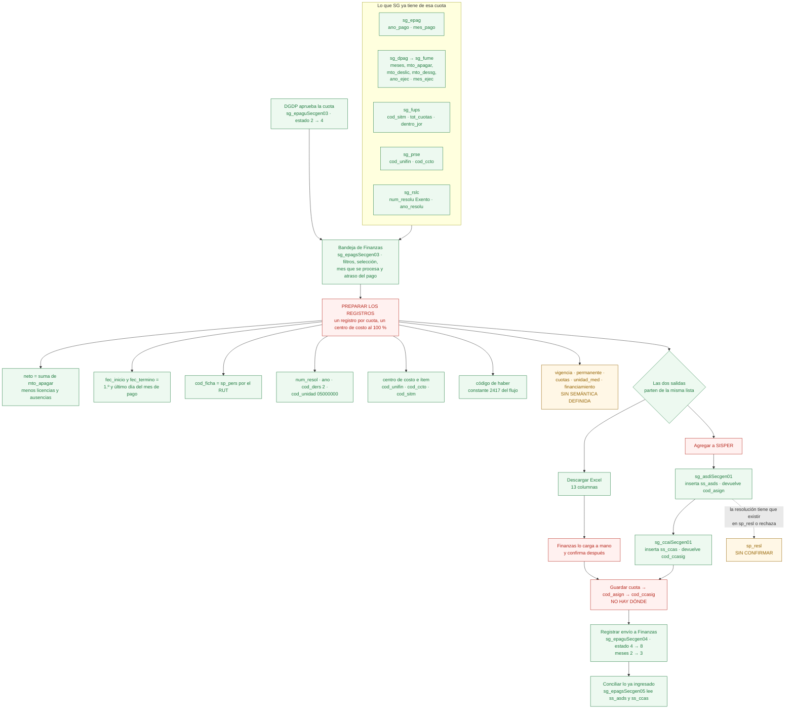

# Plan de implementación: ingreso a SISPER desde la bandeja de Finanzas

Qué cubre: el último paso del pago. Finanzas toma cuotas aprobadas, ve los
registros que se van a crear, y los lleva a SISPER por dos caminos que parten
del mismo origen — el archivo Excel, o el botón que ejecuta los PA.

Qué **no** cubre: tocar lo ya desarrollado de creación de cuotas, el envío del
solicitante, la visación DGDP, ni el catálogo de estados de la cuota. La cuota
sigue su camino 4 → 8; el estado del *registro SISPER* es un dato nuevo y
aparte.

El contraste contra el código está en §F5 de
[implementacion_bandeja_finanzas.md](implementacion_bandeja_finanzas.md). Este
documento es el plan; no autoriza desplegar nada.

---

## El flujo, en un diagrama

Verde: existe y funciona hoy. Ámbar: el dato existe pero no está definido con
qué valor viaja. Rojo: no existe.



Lo que el diagrama deja a la vista: **la cadena está completa en los extremos y
cortada en el medio.** Aprobar, la bandeja, los dos PA de SISPER, el cierre en 8
y la conciliación existen. Lo que no existe es la preparación que los une, y los
dos datos que esa preparación necesitaría y hoy nadie define.

---

## Fase 0 · Lo que hay que decidir antes de programar

| | Decisión | Qué bloquea |
| :--- | :--- | :--- |
| D1 | ¿La resolución del Exento está registrada en `sisper_db.dbo.sp_resl`? | El ingreso completo. `sg_asdiSecgen01` la exige y rechaza si no está. Si no lo está, hay que reponer `sg_resliSecgen01` en el flujo, contra la decisión de solo leerla. |
| ~~D2~~ | ~~¿Dónde vive el código de haber?~~ **Resuelta el 29-10-2026: constante `2417` del flujo.** | — ver «El código de haber» más abajo |
| ~~D3~~ | ~~El pago vigente de varios meses~~ **Cerrada el 30-10-2026 para las cuotas**: un registro por cuota, con las fechas del mes donde se paga. | La fila de varios meses del ejemplo no es una cuota — ver «D3 cerrada» más abajo |
| ~~D6~~ | ~~¿Hay que acumular las cuotas atrasadas en una sola?~~ **Cerrada el 30-10-2026: no. Una asignación por cuota, varias filas, y el período es el mes en que se paga.** | — queda un hueco de conciliación, no de ingreso. Ver «D6 cerrada» más abajo |
| D4 | Exentos con sufijo (`5284 RA` existe en `sp_resl`): `sg_rslc.num_resolu` es `int` y no los representa. | El manejo de excepción. Hoy esos casos fallarían sin diagnóstico. |
| D5 | ¿Puede una cuota incluir el mes en curso, o solo meses ya terminados? | Si solo terminados, toda cuota es atraso por naturaleza y la fila de «pago vigente» del Excel no sale de una cuota. Ver F1.1. |

**Fase 1 no depende de ninguna.** Se puede entregar mientras se deciden.

### El código de haber: constante `2417`, no un dato por capturar

Es la **cuenta de remuneración** bajo la cual se paga el monto en la
liquidación: `ss_asds.num_cuenta`, cuyo catálogo es `sisper_db..sp_para`
(`num_cuenta`, `des_cuenta`). Lo efectivamente pagado por persona y mes vive en
`sisper_db..ss_habe` (`num_cuenta`, `v_efectuad`), y las cuentas que empiezan
con `2` son haberes.

`2417` no viene del Excel de ejemplo: **ya lo usa el sistema**.
`sg_fupssSecgen13` excluye trece cuentas del total de haberes con que calcula el
tope, y el maestro `template-du09/.../maestros/Obtiene Tope para Prestaciones.sql`
documenta cada una:

```
"2414",  -- Bono de Cargo Fiscal
"2417",  -- D.U. 288, Asig. de Prest. de Servicios
"2418")  -- Prest. de Serv. Docentes Especiales
```

Que el cálculo del tope la excluya es coherente: un pago de prestación no debe
inflar el tope que limita los pagos de prestación.

Por eso el haber **no necesita tabla nueva ni columna en `sg_fups`**: es una
constante del flujo, del mismo orden que `cod_ders = '2'` y
`cod_unidad = '05000000'`. La propuesta anterior de un catálogo queda descartada.

Dos límites de esa constante:

- `2418` es «Prest. de Serv. Docentes Especiales», **otra prestación**, no una
  variante del DU288. Mientras la bandeja filtre `cod_modprs = 2` —como ya hace
  `sg_epagsSecgen03`— el código es `2417`. Si el flujo llegara a cubrir docentes
  especiales, sería `2418`.
- `sg_asdiSecgen01` valida `@numero_cuenta` contra `sp_para` desde el
  29-10-2026. Antes lo aceptaba sin consultar el catálogo, así que un código
  equivocado se insertaba como una fila mal pagada; ahora devuelve un mensaje.

### D3 cerrada: un registro de `ss_asds` por cuota (30-10-2026)

La especificación de `sp_asds1` —el PA externo que `sg_asdiSecgen01` reemplaza—
lo dice sin ambigüedad:

> inserta la asignación (en el caso de las prestaciones de servicio, se debe
> ingresar un registro por cada cuota, donde la fecha de inicio y término debe
> ser las fechas del mes donde se pagan)

Esto cuadra con lo que ya está escrito y lo confirma por tres lados:

- `sg_asdiSecgen01` exige que el período abarque del primer al último día **del
  mismo mes**. No había que ampliar esa validación: era la regla.
- `sg_epagsSecgen05` une `ss_asds` por el mes de pago de `sg_epag`, con
  `f_inicio` = día 1 y `f_termino` = último día de ese mes. El archivo y el
  ingreso hablan del mismo registro.
- Ni `permanente` ni `cuotas` ni un rango 01/09–31/12 entran para una cuota.

**Consecuencia sobre el Excel:** `Fec_inicio` y `Fec_Termino` dicen **cuándo se
paga**, no qué se trabajó. Los meses trabajados no viajan en el archivo; están
en la bandeja, en «Meses cubiertos». Por eso la fila de 995.554 del 01/09 al
31/12 del ejemplo **no puede ser una cuota**: abarca cuatro meses y
`sg_asdiSecgen01` la rechazaría. Es la asignación mensual de la prestación,
registrada una vez —la hipótesis de F1.1, ahora con respaldo—. Queda por
confirmar quién la crea y cuándo, pero ya no compite con el grano de las
cuotas.

### D6 cerrada: una asignación por cuota, con el mes en que se paga (30-10-2026)

> **Este documento se equivocó tres veces en D6 y conviene dejarlo escrito.**
> Primero concluyó que había que reprogramar el `mes_pago` de la atrasada.
> Después que cada cuota conservara su mes porque el guard impedía lo
> contrario. Después que, si el período era el mes en que se paga, había que
> acumular las atrasadas en una sola cuota. **Las tres salían del mismo error**:
> dar por buena una regla de negocio que no existe en SISPER y que habíamos
> escrito nosotros.

El PA original, `pa_externos_no_crear/sspasd1.sql`, **no controla duplicados**.
Calcula el siguiente `cod_asign` de la ficha e inserta:

```sql
select  @codigo_asignac = convert(varchar, max(convert(int, cod_asign)) +1) from ss_asds
where cod_ficha = @codigo_ficha
```

`ss_asds` identifica cada fila por `cod_asign` —correlativo por ficha—, **no por
el período**. Varias asignaciones de una persona con el mismo mes son legales y
siempre lo fueron. El rechazo por período repetido lo agregamos en la
estandarización, y bloqueaba exactamente el caso que la especificación describe:

> se debe ingresar **un registro por cada cuota**, donde la fecha de inicio y
> término debe ser las fechas del mes donde se pagan

Las dos cláusulas se sostienen juntas sin inventar nada: **una asignación por
cuota, todas con el período del mes en que se pagan**. Dos atrasadas de abril y
mayo pagadas en octubre son dos filas con período de octubre y `cod_asign`
distinto. **No se acumulan**: acumular era una salida al guard, y el guard no
debía existir.

Retirado el 30-10-2026 de `sg_asdiSecgen01`, con su motivo en la cabecera y en
el README de `pa_externos`. Protegerse de ingresar **la misma** cuota dos veces
no puede hacerse en el PA: no recibe la cuota y nada en `ss_asds` la nombra, así
que esa idempotencia le toca al flujo que invoca.

#### Lo que queda abierto: la conciliación, no el ingreso

El ingreso queda resuelto. Lo que no, es volver del archivo a la cuota.
`sg_epagsSecgen05` une `ss_asds` por `epag.ano_pago`/`mes_pago`:

```sql
and convert(char(8), asds.f_inicio, 112)
    = convert(char(8), convert(datetime,
        convert(char(4), epag.ano_pago)
        + right('0' + convert(varchar(2), epag.mes_pago), 2) + '01', 112), 112)
```

Eso deja dos problemas, los dos de ida y vuelta entre cuota y asignación:

1. **La atrasada no calza.** Asignación de octubre contra cuota con `mes_pago`
   de abril: la unión falla y devuelve cero filas. **Es el `[]` de la prueba del
   29-10**, que hasta ahora se atribuía solo a que nadie había creado el
   registro.
2. **Dos cuotas del mismo mes calzan de más.** Con dos asignaciones de octubre
   para la misma persona y resolución, la unión —ficha, resolución, período— hace
   que **cada cuota cruce con las dos**, y el archivo repetiría el monto. No hay
   nada que distinga una asignación de la otra: `sg_epag` no guarda `cod_asign`.

Los dos son el mismo hueco, el de trazabilidad ya registrado: **falta el enlace
entre la cuota y su asignación**. Con `cod_asign` guardado en el momento del
ingreso, la conciliación une por ese código y los dos problemas desaparecen sin
tocar fechas. Sin él, cualquier arreglo de la unión es una heurística sobre
fechas que seguirá fallando en los casos de arriba.

Eso es un cambio de esquema en `sg_epag` y está fuera de lo decidido hoy —«no se
crea ninguna tabla ahora»—. Mientras no exista:

- La **proyección** desde SG es la vista utilizable: no depende de la unión.
- El **archivo conciliado** sirve para lo que está al día y con una sola cuota
  por mes; fuera de eso hay que revisarlo, y por eso la bandeja avisa cuando dos
  cuotas comparten mes de pago. El aviso **ya no dice que SISPER las rechaza**
  —eso era falso—, dice que la conciliación no puede atribuirlas.

#### Los dos ejes, que se confunden

| Eje | Dónde vive | Valores | Qué dice |
| :--- | :--- | :--- | :--- |
| **Estado de la cuota** | `sg_epag.cod_estcuo`, catálogo `sg_ecuo` | 1 Propuesta · 2 En visación · 3 Devolver · 4 Aprobada · 8 Enviada a remuneraciones · 10 Rechazada · 11 Devuelta de Finanzas | en qué parte del flujo está |
| **Oportunidad del pago** | derivado, no persistido | Atrasada · Del mes · Mes posterior · Sin mes de pago | si su mes de pago llegó tarde al mes que se paga |

Son ortogonales: una cuota **aprobada y atrasada** es el caso normal de esta
bandeja, no una excepción. La bandeja de Finanzas consulta un solo estado a la
vez —4 por enviar, 8 ya enviadas—, así que el estado vive en el filtro y la
oportunidad en cada fila.

El eje de oportunidad **no se persiste y no debe persistirse**: depende del mes
que se paga, que cambia en cada proceso. La misma cuota es «del mes» en octubre
y «atrasada» en diciembre. Un `cod_estpag` o una columna nueva quedarían
desactualizados sin que nada los toque.

#### Cómo quedó en la bandeja (30-10-2026)

- **El mes que se paga es «Pago hasta»**, el extremo del rango de filtro. No es
  `new Date()` ni una entrada aparte: es el mes que quien arma el archivo ya
  declara al filtrar, y duplicarlo en otro campo abría dos sitios para decir lo
  mismo.
- **«Pago desde» abre vacío.** Antes la bandeja abría con desde = hasta = mes
  actual, de modo que **escondía todas las atrasadas**: justo las cuotas que
  esta bandeja existe para arrastrar. Ahora entra todo lo pagable hasta el mes
  que se paga.
- **Columna «Oportunidad del pago»**, entre el número de cuota y las columnas
  del archivo —califica las dos fechas que sí van al archivo, así que no se
  intercala entre ellas, que son el formato—. Con los meses de atraso debajo,
  contados sobre `ano * 12 + mes`.
- **Filtro de oportunidad** junto al estado: «Atrasadas y del mes» por omisión,
  o una sola clase cuando hay que aislarla.
- El aviso de mes duplicado se conserva tal cual: es el único caso que SISPER
  rechaza de verdad.

---

## Fase 1 · El atraso del pago, solo lectura — **entregada el 29-10-2026**

Una cuota está **atrasada** cuando su mes de pago programado es anterior al
período de remuneración que Finanzas está procesando. Es lo único que la
columna afirma: nada se escribe en SISPER ni en SG.

### Lo que se hizo, y en qué se apartó del plan

El plan decía «PA nuevo `sg_epagsSecgen06`» con el período de proceso como
parámetro y la clasificación derivada en el PA. **No se hizo así, y tampoco se
tocó ningún PA**, por dos razones que aparecieron al mirar el código:

1. `sg_epagsSecgen03` ya devuelve `ano_pago` / `mes_pago`, y lo consumen las dos
   bandejas. Un PA nuevo habría repetido el bloque de autorización DGDP y las
   treinta y tantas columnas del agregado para agregar una sola derivada: dos
   lugares donde corregir cada cambio.
2. El período de proceso **no es un dato de la base**: lo elige quien está
   preparando la remuneración. Meterlo como parámetro de `sg_epagsSecgen03`
   habría cambiado la firma de un PA que también usa la revisión DGDP, donde
   ese período no existe.

Con `ano_pago` / `mes_pago` basta para el atraso del pago, así que la fase
quedó sin cambios en la base ni en el backend:

- **PA**: ninguno. `sg_epagsSecgen03` queda como estaba.
- **Backend**: ninguno. El dato viaja en la bandeja que ya se consulta.
- **Regla**: `utils/services-provision/normative/paymentArrears.js`, una sola
  definición que leen las dos bandejas. La diferencia en meses se calcula como
  `ano * 12 + mes`, nunca restando los enteros `aaaamm` —`202601 - 202512` no
  es 1—, igual que `per_pendiente_min` en `cambios_pa/README.md`. Ocho pruebas
  en `__tests__/paymentArrears.test.cjs`.
- **Frontend**: el mes de remuneración en proceso es una sección propia de la
  bandeja de Finanzas, **antes de los filtros** y que «Limpiar filtros» no
  toca: no quita ni agrega filas, cambia cómo se lee la tabla completa. Viaja
  en la URL como `proceso` para que volver desde el detalle lo conserve. La
  columna «Oportunidad del pago» va junto a «Mes a pagar», porque lo califica,
  y se enciende con `showArrears` en el esquema compartido —apagada en la
  revisión DGDP, que no tiene ese mes—.

La clasificación quedó en el frontend y no en el PA. Es una excepción
consciente al criterio de `cod_estpag` —que sí es derivable solo de la base—, y
el requisito de una sola definición se cumple con el helper compartido y sus
pruebas, no con SQL.

### F1.1 Los dos atrasos, que no son el mismo (29-10-2026)

| | Qué compara | Significa |
| :--- | :--- | :--- |
| **Atraso del pago** | el mes de pago de la cuota contra el mes que se procesa | el pago se quedó atrás. Cuota con pago en octubre, consultada en diciembre: dos meses de atraso |
| **Desfase de la ejecución** | el último mes trabajado contra el mes de pago | hay trabajo acumulado. Enero a marzo pagado en octubre: siete meses |

El atraso del pago **no se mide contra la fecha de aprobación**. Una cuota
aprobada a tiempo en octubre y todavía sin enviar en diciembre está atrasada en
diciembre; medirla contra la aprobación congelaría el atraso y nunca crecería.

**El desfase de la ejecución no se muestra, y es una decisión, no un olvido**
(29-10-2026). Toda cuota cubre meses anteriores a su mes de pago, porque solo se
paga ejecución terminada —`cant_cuotas_disp` cuenta las cuotas «cuya ejecucion
ya termino» y `sg_epaguSecgen02` lo valida—. Septiembre trabajado y pagado en
octubre es el calendario normal: una columna que lo marcara estaría encendida
siempre, y la distancia en meses sobre una cuota vieja da cifras que no dicen
nada —«127 meses acumulados»—. Los meses que la cuota cubre ya están a la vista
en «Meses cubiertos», con sus fechas, que es el dato comprobable. Lo que se
compara es el mes a pagar contra el mes y año en proceso, y nada más.

**El mes en curso no es pagable.** Generando en marzo, la cuota llega hasta
febrero; en abril, hasta marzo. Abril entra en mayo. Única excepción, que
`cant_cuotas_disp` ya contempla: abril sí entra si la prestación **cerró** antes
de hoy dentro de abril, para no hacer esperar a una prestación corta.

**Consecuencia para F4 y el Excel (D5).** Si una cuota nunca puede contener el
mes en curso, entonces toda cuota es atraso por naturaleza y la fila de **pago
vigente** del archivo —995.554 del 01/09 al 31/12 en el ejemplo— **no sale de
una cuota**: sería la asignación mensual de la prestación, registrada una vez
para que SISPER la pague cada mes. Eso explicaría por qué `ss_asds` tiene
`permanente`, `cuotas` y `unidad_med`, que `sg_asdiSecgen01` ya acepta. Es
hipótesis, no dato: se confirma junto con D3.

**El mes de pago no lo define DGDP.** Lo escriben solo `sg_epagiSecgen01` al
crear y `sg_epaguSecgen01` al editar, en estados 1 y 3 — el jefe de proyecto.
`sg_epaguSecgen03/04/05` no lo mencionan. Para cambiarlo, DGDP observa la cuota
y el jefe de proyecto la edita.

### Lo que la columna distingue

| Estado | Cuándo | Color §5.4 |
| :--- | :--- | :--- |
| Atrasada | el mes de pago programado es anterior al que se procesa | advertencia |
| Del período | coinciden | éxito |
| Programada después | el mes de pago es posterior al que se procesa | información |
| Sin mes de pago | falta `ano_pago` / `mes_pago` o el mes de proceso | neutro |

Bajo el estado, cuando hay atraso, la celda agrega «N meses de atraso» contados
sobre `ano * 12 + mes`. No se muestra nada más: los meses que la cuota cubre
están en «Meses cubiertos».

### Certificación

**Esta fase no lleva certificación de base de datos**: ningún PA cambió. Se
verifica en la aplicación —pruebas de la regla, validador visual, lint y
`nuxt build`— y nada de ella escribe en SISPER ni en SG.

---

## Fase 2 · Preparar los registros desde SG

Hoy el Excel sale de `ss_asds` y `ss_ccas`: exporta asignaciones que ya existen.
Esta fase crea el origen que falta — los registros que **deben** ingresarse,
armados con datos de SG.

**PA nuevo** `sg_epagsSecgen07`. Misma entrada que el Excel actual —revisor,
estado y lista de cuotas—, y devuelve una fila por registro a crear, con los
campos que los dos PA de ingreso necesitan: Exento y año de `sg_rslc`, unidad
`05000000`, `cod_ders = '2'`, ficha de `sp_pers`, el haber `2417`, monto
neto, fechas del mes de pago, centro de costo con `cod_unifin` + `cod_ccto`,
ítem con `sg_fups.cod_sitm`, porcentaje 100, y el tipo de registro —atraso o
vigente— que viene de la fase 1.

`sg_epagsSecgen05` **no se borra**: queda como la conciliación de lo que ya
está en SISPER, que es la pregunta 3 de la evaluación previa. Son dos lecturas
con propósitos distintos y conviven.

**Frontend**: la descarga del Excel pasa a leer de este origen. Las dos guardas
cambian de sentido: `item_coincide` y `porcentajes_suman_100` hoy comparan
contra SISPER, y pasan a describir lo que se va a escribir. Las fechas se
escriben como fecha real de Excel, no como el texto `dd-mm-yyyy` que arma
`excelDate` hoy. `Nº Resol` se entrega con el formato del ejemplo.

**La bandeja muestra estas mismas filas**, con su tipo, fechas y monto, para
que Finanzas vea qué se va a registrar antes de elegir un camino.

---

## Fase 3 · Dónde guardar la trazabilidad

Sin esto no se puede responder «¿esta cuota ya tiene asignación vinculada?», y
la detección de duplicados queda en el cruce por funcionario, resolución y mes,
que no es un identificador seguro: dos cuotas pueden coincidir en los tres.

`sg_epag` tiene diez columnas y ninguna para `cod_asign`. Hace falta **tabla
nueva**, así que esta fase es cambio de esquema y va en `datos_base/`, no en
`cambios_pa/`.

Propuesta, a confirmar el nombre y los largos contra el esquema:

```
sg_pasi  (id_funprse, nro_cuota, corr_pasi)
   cod_ficha, num_resol, ano_resol        la clave con que se inserto
   cod_asign, cod_ccasig                  lo que SISPER devolvio
   mto_asign, f_inicio, f_termino         lo que se registro
   tip_regpa                              atraso o vigente
   cod_estpa                              preparado | exportado | registrado | conciliado | error
   rut_usuario, fec_registro, msg_error   auditoria del intento
```

Más su catálogo de estado y los PA `sg_pasiiSecgen01` (insertar el intento),
`sg_pasiuSecgen01` (cerrar el resultado) y `sg_pasisSecgen01` (leer lo
registrado de una cuota).

El estado del registro vive acá, **no** en `sg_ecuo`. La cuota conserva sus
siete estados y su recorrido 4 → 8; agregar «exportado» al catálogo de la cuota
mezclaría dos granos —una cuota tiene varios registros— y tocaría un catálogo
que ya está en uso.

---

## Fase 4 · El ingreso con los PA

Dos PA, no tres: la resolución se lee, no se crea.

```
por cada registro preparado
  1. escribir el intento en sg_pasi              -> estado preparado
  2. sg_asdiSecgen01                             -> guardar cod_asign
  3. sg_ccaiSecgen01 con ese cod_asign           -> guardar cod_ccasig
  4. cerrar el registro                          -> estado registrado
```

**Los dos PA no comparten transacción.** Cada uno confirma su propia inserción,
así que un fallo en el paso 3 deja una asignación sin centro de costo. Por eso
el `cod_asign` se guarda en el paso 2 y no al final: al reintentar, el
orquestador lee `sg_pasi`, encuentra la asignación ya creada y continúa en el
paso 3 con el mismo `cod_asign`, en lugar de insertar otra.

**Antes de insertar** se evalúa, en una lectura: si los meses ya están
comprometidos en otra cuota activa, si la cuota ya tiene registro vinculado, si
hay asignaciones SISPER coincidentes sin vínculo —esas quedan «pendiente de
conciliación» y no se insertan—, y si una asignación existente tiene sus
centros de costo completos.

**Backend**: la orquestación va en un servicio, no en el controlador ni en el
repositorio. El repositorio ejecuta un PA cada uno; el servicio decide el orden,
la reanudación y el éxito parcial; el controlador autentica, recibe el DTO y
devuelve el resultado por registro. El éxito parcial es el caso normal y se
informa como tal, igual que ya hace `markInstallmentsSentToPayroll`.

**Frontend**: botón «Agregar a SISPER» con modal de confirmación —cuántos
registros, de cuántas cuotas, monto total, y que no se deshace desde el
sistema—, y pantalla de resultado por registro con los que fallaron y por qué.

---

## Fase 5 · Exportado, registrado y pagado son tres cosas

Descargar el archivo marca los registros como exportados. El ingreso los marca
como registrados. Ninguno de los dos acredita que la remuneración se pagó: eso
es una confirmación posterior.

Para la carga por Excel, marcar la cuota como ingresada exige confirmar después
los correlativos que SISPER creó — lo que la fase 4 hace sola cuando el ingreso
es directo. Queda como acción explícita de Finanzas sobre registros exportados.

---

## Fase 6 · Verificar que los dos caminos coinciden

Comparar que el Excel y el ingreso directo produzcan los mismos registros para
la misma selección: mismo grano, mismos montos, mismas fechas. Más atraso, pago
vigente, fallo parcial en el centro de costo, reintento sobre un parcial, y
duplicado detectado antes de insertar.

---

## Recomendación: cómo definir los datos que esperan los PA y el Excel

### Lo que cada PA pide, y de dónde sale

`sg_asdiSecgen01` → `ss_asds`:

| Parámetro | Qué mandar | Origen | |
| :--- | :--- | :--- | :--- |
| `@numero_resol` | número Exento | `sg_rslc.num_resolu` | ✔ con la salvedad de D4 |
| `@codigo_decres` | `'2'` | constante del flujo | ✔ |
| `@codigo_unidad` | `'05000000'` | constante del flujo | ✔ |
| `@ano` | año del Exento | `sg_rslc.ano_resolu` | ✔ |
| `@codigo_ficha` | ficha | `sp_pers` por el RUT de `sg_fups` | ✔ |
| `@numero_cuenta` | `2417` | constante del flujo, validada contra `sp_para` | ✔ |
| `@vigencia` | — | **el PA no le da semántica** | ✘ |
| `@fec_inicio` / `@fec_termino` | 1.º y último día del mes de pago | `sg_epag.ano_pago` / `mes_pago` | ✔ |
| `@observacion` | referencia a la cuota | se puede componer | ✔ |
| `@valor` | neto aprobado | `sum(mto_apagar - mto_deslic - mto_dessg)` | ✔ |
| `@permanente` · `@cuotas` · `@unidad_medida` | — | **sin semántica** | ✘ D3 |

`sg_ccaiSecgen01` → `ss_ccas`: ficha y `cod_asign` del paso anterior,
`@unid_finan` y `@centro_costo` de `cod_unifin` / `cod_ccto` de la prestación,
`@cod_sitm` de `sg_fups.cod_sitm`, `@valor_asignado` con el mismo neto, las
mismas fechas — y `@financiamiento`, que tampoco tiene origen identificado.

Ni el PA nuevo ni el legacy `sspasd1` definen `vigencia`, `permanente`,
`cuotas`, `unidad_med` ni `financiamiento`: los guardan tal como los reciben.
No se pueden deducir del código.

### La recomendación, en orden de lo que más desbloquea

**1. Pedir una fila real de `ss_asds` y su `ss_ccas` de un pago DU288 ya
ingresado a mano por Finanzas.** Es una consulta y responde de una vez
`vigencia`, `permanente`, `cuotas`, `unidad_med`, `financiamiento`, el código de
haber que están usando y —lo más importante— **D3**: si las filas actuales
tienen `permanente = 'N'` con un rango de un mes, entonces la fila de pago
vigente del Excel es otro mecanismo y la cuota siempre es atraso; si usan
`permanente = 'S'` con `cuotas`, ese es el modelo recurrente y no hay que
ampliar la validación de mes único. Copiar lo que ya funciona es más seguro que
derivar la semántica de un PA que no la tiene.

**2. Un registro por cuota, con un solo centro de costo al 100 %.** La
prestación tiene un único `cod_unifin` + `cod_ccto` —así los entrega
`sg_epagsSecgen03`—, así que cuando SG crea el registro hay una sola llamada a
`sg_ccaiSecgen01` con el monto íntegro. El prorrateo entre varios `ss_ccas` que
hace `sg_epagsSecgen05` es propio de la conciliación, donde la asignación ya
existe y puede traer varias líneas. Con esto `Porcentaje CC = 100` deja de ser
una constante arbitraria: es la consecuencia de haber un solo centro.

**3. El código de haber, constante `2417`.** Resuelto: `sp_para` la nombra
«D.U. Asig. de Prest. de Servicios» del 288 y el cálculo del tope ya la conoce.
No va tabla ni columna; va como constante del flujo junto a `cod_ders = '2'` y
`cod_unidad = '05000000'`, y `sg_asdiSecgen01` la valida contra el catálogo.
El detalle está en «El código de haber» de la Fase 0.

**4. El Excel, proyección de la misma lista, nunca una consulta aparte.** Las
trece columnas se derivan de los registros preparados: `Porcentaje CC` como
`valor_asignado / valor × 100`, fechas como fecha real de Excel y `Nº Resol` con
el formato del ejemplo. Así el archivo y el botón no pueden discrepar, que es la
condición que el alcance pone.

### Dos límites de los PA que hay que atajar antes de llamarlos

**El monto tiene techo.** `@valor` es `decimal(9,2)` y el PA solo valida que sea
mayor que cero: por encima de 9.999.999,99 no cabe. `sg_fups.mto_total` es
`decimal(19,2)`, así que una cuota puede superarlo. Hay que rechazar el registro
antes de enviarlo, con un mensaje propio, en lugar de dejar que falle o se
trunque en la base.

**El correlativo del centro de costo es global.** `sspcca1` —y por herencia
`sg_ccaiSecgen01`— calcula `cod_ccasig` como el máximo sobre **toda** `ss_ccas`
donde el código empieza con `S`, no por persona. Dos ingresos simultáneos pueden
chocar. El ingreso debe ir de a un lote por vez y leer el `cod_ccasig` que el PA
devuelve, nunca suponerlo. `cod_asign` es por persona, más seguro, pero la misma
precaución vale para dos lotes de la misma persona.

---

## Estándares de desarrollo esperados

### PA

Formato según `nuevo_workflow_fase_2/reglas_bdd_pa/reglas_estandarizacion_pa.md`:

- Estructura canónica de cinco bloques: `use secgen_db` · `drop` condicional por
  `sysobjects` / `sysusers` · cabecera de comentario · `create procedure` ·
  `grant execute ... to UsuaVrac`.
- Cabecera obligatoria con `Entrada :`, `Objetivo :`, `Creacion:` y
  `Actualizacion: Sin registro`, **sin tildes ni ñ** — ASCII de 7 bits puro.
- SQL, tipos, funciones y tablas temporales en minúsculas. Un parámetro por
  línea con cuatro espacios; `as` en su propia línea.
- `.txt` desplegable **idéntico** al `.sql`, CRLF, ASCII puro.
- Sin `execute` comentados al final y **sin comentarios de desarrollo en el
  cuerpo**: nada de `TODO`, `DU288`, `backend` ni notas de diseño. El SQL se
  explica solo; el porqué va en el README de su carpeta.
- Mensajes sin nombres de tabla ni detalle interno. Contrato de retorno: éxito
  con `status`, `code` y `msg`; error con el mensaje descriptivo únicamente y
  nunca `status = 0`.
- Transacción por mutación con el control de `@@transtate` 2 y 3, y `rollback`.
- Todo PA nuevo vive en `cambios_pa/`, en la carpeta de su tabla, con su par
  SQL/TXT y una entrada en el README de esa carpeta y en el orden de despliegue.
- **Pagos no modifica un PA ajeno para sus propias necesidades: crea uno nuevo.**
  `sg_asdiSecgen01` y `sg_ccaiSecgen01` sí son de este paquete, así que
  ampliarlos es legítimo; `sg_epagsSecgen05` no se reescribe para otro
  propósito, se deja como conciliación.
- Los cambios de esquema —la tabla de la fase 3 y su catálogo— van en
  `datos_base/` con su número de orden, no en `cambios_pa/`.

### Backend

- Orden de capas: PA → repositorio → servicio → controlador → modelo/DTO. El
  repositorio es la única capa que llama a `SyBaseService`; la orquestación de
  la fase 4 es del servicio; el controlador autentica, recibe el DTO y
  estandariza la salida, en 20 a 30 líneas.
- Inyección de dependencias de LoopBack: `@inject`, `@repository`, `@service`.
  Nada instanciado a mano.
- Sin `any` en los límites que se toquen. Lo que llega del PA se valida y se
  convierte en el modelo; los nulos se modelan explícitos.
- Validación en el borde y errores de Sybase mapeados a errores de aplicación:
  nunca el fallo crudo hacia el frontend.
- Una lectura por operación, no una por cuota. La evaluación previa de la fase 4
  y la preparación de la fase 2 son consultas masivas con la lista de cuotas.
- RUT normalizado y enmascarado en logs; ningún identificador ni monto
  detallado en consola.
- Los modos legacy y DU288 siguen separados: nada de esto cambia el camino PDS
  anterior.
- Lenguaje de dominio en español donde es terminología oficial — cuota,
  asignación, haber, centro de costo, Exento.

### Frontend

- Estándar visual obligatorio
  `estandar_visual/estandar_visual_obligatorio_du288.md`: tipografía y
  espaciado de la §5, colores **solo** desde las variables `--pds-du288-*` sin
  hexadecimales nuevos cuando el significado ya tiene token, modales con pie
  real y cancelar a la izquierda del confirmar, montos alineados a la derecha
  en tablas.
- Todo texto visible al usuario en `lang/es/pds.js`. Ningún rótulo literal en
  plantilla ni en computada.
- Lo derivado se calcula una vez y se comparte: la clasificación de atraso
  viene del PA, el rótulo del tipo de registro sale del lang, y el formato de
  cuota sigue usando `formatInstallmentOfTotal`.
- Estados de carga, error, vacío y parcial explícitos, y la pantalla
  responsive en 1366, 1024, 768 y 375 px.

### Verificación por entrega

- Backend: `npm run build` y
  `npx lb-mocha -r ./test-setup.js "dist/__tests__/unit/**/*.js"`.
- Frontend: `node utils/validateDu288Ui.js`, `npm test`,
  `npx eslint --ext .js,.vue` y `npx nuxt build`.
- Pruebas nuevas para lo que no se puede ver a ojo: la diferencia de meses del
  atraso, el prorrateo del monto entre centros de costo con su residuo, la
  reanudación sobre un parcial con el mismo `cod_asign`, y la paridad entre el
  Excel y el ingreso directo.
- **Que el build de TypeScript pase no verifica un cambio de Sybase.** Cada PA
  nuevo entrega su lista de comprobaciones de certificación y se declara sin
  probar en base de datos hasta que se ejecute contra ASE.

---

## Orden sugerido

Fase 1 primero: no depende de ninguna decisión, y deja a la vista el dato que
hoy falta —qué está atrasado— sin escribir en ninguna parte. **Entregada el
29-10-2026.** Después las fases 2 y 3 en paralelo, porque la preparación y la
tabla de traza no se tocan. La fase 4 va sola, cuando D1 y D3 estén
respondidas y la tabla exista. Las fases 5 y 6 cierran.

Las fases 2 a 6 quedan sin empezar a propósito. Con D2 resuelta, la fase 2 ya
tiene cinco de sus siete columnas definidas y el haber como constante; lo que
le falta es el grano, que depende de D3. La fase 4 necesita además D1 —que la
resolución esté en `sp_resl`— y la tabla de la fase 3, cuyo nombre y largos hay
que confirmar contra el esquema. Programarlas antes obligaría a adivinar el dato
que se escribe en SISPER.

Lo que no conviene adelantar es la fase 4 sin la fase 3: sin la traza, un
ingreso parcial no se puede reanudar ni distinguir de un duplicado.
